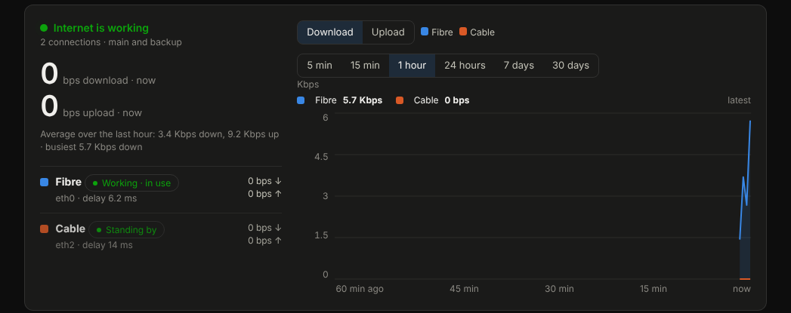
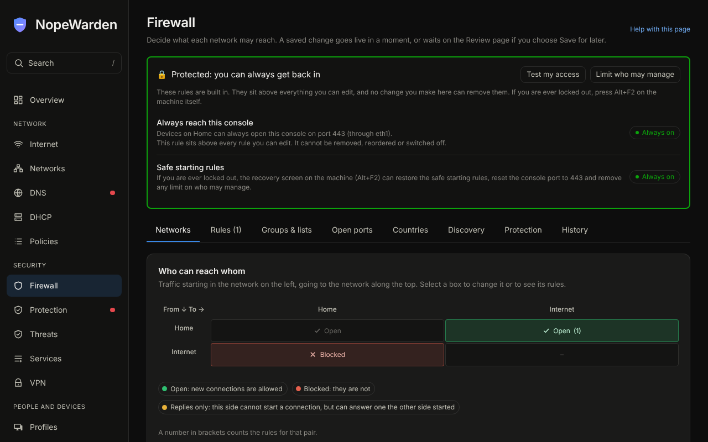
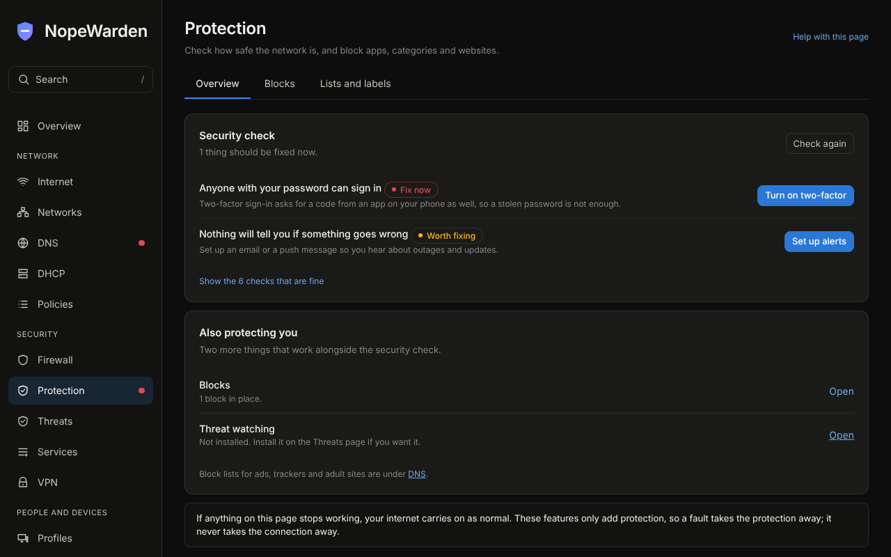
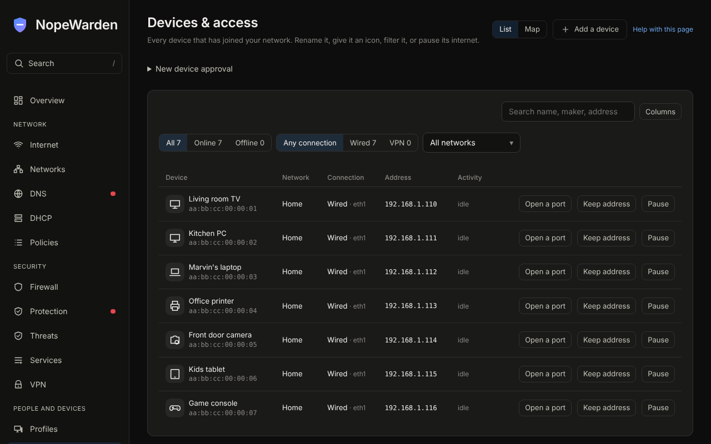
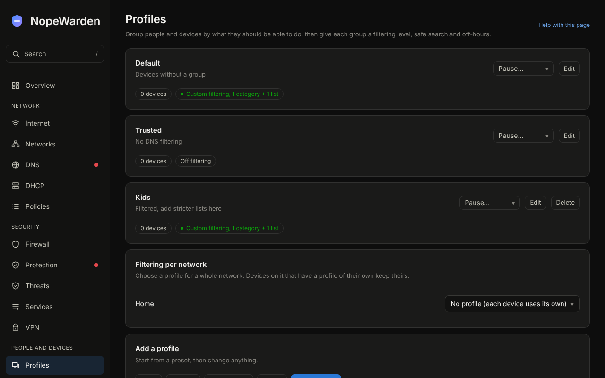

<p align="center">
  
</p>

<h1 align="center">NopeWarden</h1>

<p align="center"><b>Hard on threats. Easy on humans.</b></p>

<p align="center">
A firewall, DNS server, DHCP server and gateway for your network in one small appliance,<br>
with a web console that explains itself. It installs from a USB stick onto an ordinary x86 PC.
</p>

<p align="center">
  
</p>

## Why NopeWarden

Most routers either hide everything behind a few switches or hand you a wall of rules. NopeWarden does neither. Every page says what it is for and what will happen, rules read like sentences, and the common jobs (pause a device, keep its address, open a port, send traffic through a chosen connection) take three clicks or fewer.

It is also hard to break. Every change goes live, then NopeWarden checks that you can still reach it. If you cannot, the old settings come back by themselves within 60 seconds, so you cannot lock yourself out.

## What you get

**Internet.** Connect through DHCP, a fixed address or PPPoE (with a VLAN tag if needed). Use failover or load sharing across several connections, name connection groups, and keep delay low with speed control that follows what your line really delivers. USB Ethernet adapters work as ports.

**Firewall.** Give each network a type (Trusted, Private, Guest, Isolated or Custom) and NopeWarden writes the rules. A grid shows who can reach whom, rules read as lines with live counters, and a card lists everything the firewall always does before any rule of yours. A protected set of rules always lets you back in.

**DNS.** A fast caching resolver with its own upstream handling, ad, tracker and malware blocking, your own names, and a "why was this blocked?" lookup.

**DHCP.** Addresses for each of your networks, reservations, automatic names for devices, and a warning before a pool fills up.

**Profiles and devices.** Group devices by what they should be able to do (Kids, Guests, Smart home, Work) and give each profile a filtering level, safe search and off-hours. Rename devices, give them icons, pause their internet, and see everything on a map.

**Protection and threats.** A security check that says what to fix and why, blocks for apps, categories and websites, and optional threat watching for infected devices, break-in attempts and probing, reported in plain words.

**VPN.** WireGuard and OpenVPN, with UPnP when you want it.

**Logs and diagnostics.** Searchable events, a map of where connections go, data use per device, and a Diagnostics page that shows how NopeWarden itself is running, with a support bundle that hides passwords and keys.

**Updates.** One schedule for every job, signed releases only, and a Review page that lists every waiting change in words before it goes live.

**Sign-in.** Two-step sign-in is required for the administrator.

<table>
  <tr>
    <td></td>
    <td></td>
  </tr>
  <tr>
    <td></td>
    <td></td>
  </tr>
</table>

The pictures come from a demo console with made-up data.

## Try it

1. Download `nopewarden-<version>-amd64.iso` from the latest release on the Releases page.
2. Write it to a USB stick (at least 4 GB) with [balenaEtcher](https://etcher.balena.io/) or `dd`.
3. Boot the PC from the stick. If it will not start, turn off Secure Boot in the firmware settings (the image is not signed yet). Over a serial cable, set your terminal to 115200 baud, 8N1, no flow control.
4. The screen shows a web address and a one-time code. On another computer on the same network, open that address (accept the certificate warning), enter the code, choose the disk, and install.
5. Restart without the USB stick. Open `https://nopewarden.lan` (or the address shown on the screen) and follow the setup.

The installer erases the disk you choose, and it will not let you choose the stick it started from.

## Documentation

The help for every page is built into the console (the **Help with this page** link), and the same text lives in [`docs/help`](docs/help).

## Building

```
cd web && npm ci && npm run build      # the console
go build ./cmd/nopewarden              # the program (CGO is needed for SQLite)
iso/build.sh ./nopewarden 0.1.0        # the image (root, Debian with live-build)
```

GitHub Actions does all of this on every push and attaches the image to a release (`nightly` for the latest commit, a numbered release for tags starting with `v`).

| Folder | What is in it |
|---|---|
| `cmd/nopewarden` | the program |
| `internal/` | DNS, DHCP, firewall, network, installer, API |
| `web/` | the React console |
| `tokens/` | design tokens; every colour and size in the console comes from here |
| `docs/` | help pages and the acceptance checklist |
| `iso/` | the installer image build |

## Status

Early, but complete in scope. DNS, DHCP, the zone firewall, internet connections (failover, load sharing and named connection groups), WireGuard and OpenVPN, UPnP, the web console and the installer are written and tested. The installer asks only for the disk; the account and network are set up in a browser on first start. The machine's own screens are drawn as graphics on the frame buffer, with a text fallback. Hardware testing is ongoing.

**Wireless (Wi-Fi) is not supported.** The image carries no Wi-Fi drivers or firmware, so use a separate access point.

### Known gaps

Not built yet: a sign-in code (TOTP) for OpenVPN users (each person already has their own certificate that can be revoked), DNS servers chosen per outbound tunnel, a signed Secure Boot loader, and an ARM build.
