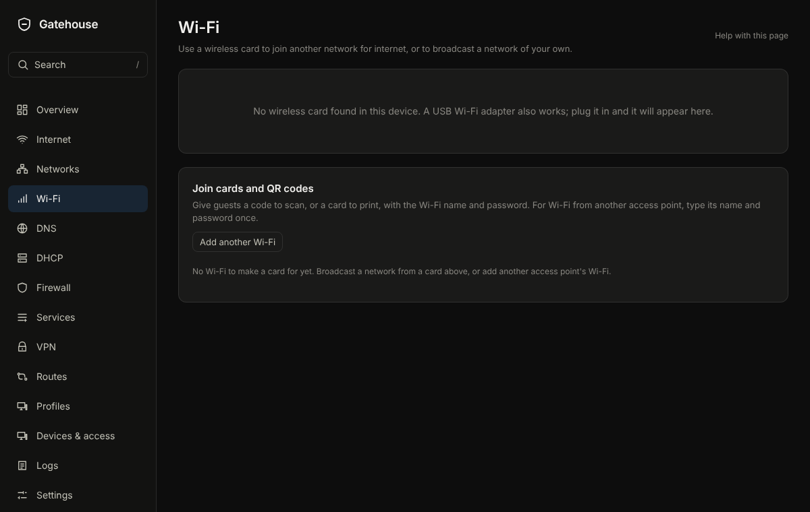

# Wi-Fi

## What it is for
Use a Wi-Fi card in the machine to broadcast a network, or to join another network such as a hotspot.

The picture is an example from a new, empty box; yours will show your own devices and numbers.

## What is on the page
- One card per Wi-Fi adapter. **What should this card do?** offers **Broadcast a Wi-Fi network** or **Join a Wi-Fi network**.
- To broadcast: **Network name**, **Password**, **Speed band** (**5 GHz** is faster, **2.4 GHz** reaches farther), **Channel**, **Country this device is in**, and **Who will use this Wi-Fi?** (**My own devices**, **Same network as wired**, **Guests** or **Smart-home gadgets**). **Allow WPA3** and **Hide the network name** are options.
- To join: **Look for networks**, pick one, enter its password. **Forget network** removes a saved one.
- **Keep the card awake** and **Restart the card automatically if it stops working** help cards that stop answering to save power.
- **Wi-Fi report** lists what a card heard nearby.

## Common tasks
1. Make a guest Wi-Fi: choose **Broadcast a Wi-Fi network**, name it, set a password, choose **Guests**, **Save**, **Review and apply**.
2. Share the password: use the printable join card, which shows a QR code.
3. Join a hotspot as your internet: choose **Join a Wi-Fi network** and pick it.

## Example
Broadcast "Home" on 5 GHz for **My own devices**, and "Home guests" on 2.4 GHz for **Guests**.

## If something goes wrong
**This card cannot broadcast here** means the card or the country setting does not allow it. Check **Country this device is in**. If the card stops answering, turn on **Turn off power saving**.
