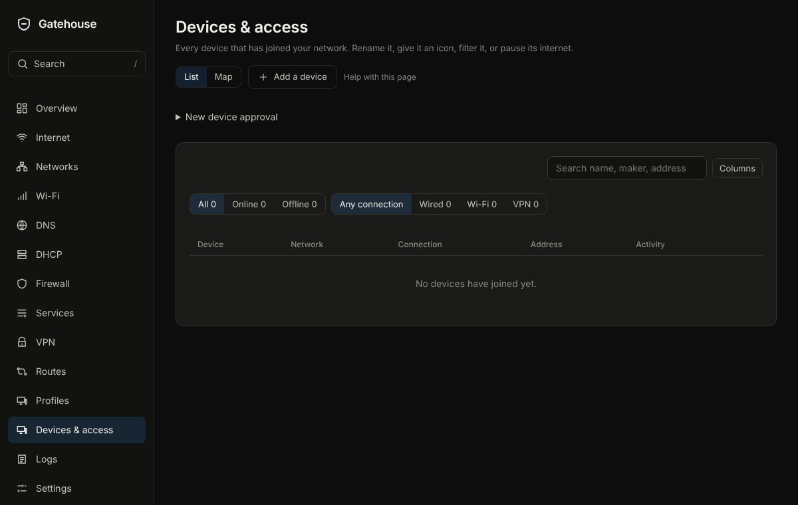

# Devices & access

## What it is for
Every device that has joined your network. Rename it, give it an icon, put it in a profile, or pause its internet.

The picture is an example from a new, empty box; yours will show your own devices and numbers.

## What is on the page
- **Search devices** and a **List** or **Map** view. **Columns and rows** chooses what the table shows.
- Each row shows the device, its network, how it is connected and whether it is allowed online. A button on the row pauses or resumes it; an offline device has **Forget**.
- Open a device to change its **Name**, **Icon**, **Profile**, **DNS filtering**, **Notes** and **Fixed address**, or **Pause the internet** for a set time. **Allowed online** turns it off without losing its settings. For a device on a VPN there is also **Sent through** and a Check. The panel also lists **Firewall rules that mention it**.
- **Add a device** records one that has not joined yet.

## Common tasks
1. Pause a device: press its row button, or open it and choose a pause length. **Resume now** brings it back.
2. Rename a device: click it, type the name, press Enter.
3. Keep a device at the same address: open it, turn on **Fixed address**.

## Example
Pause the games console for two hours at homework time: open it and choose the two-hour pause. It comes back by itself.

## If something goes wrong
A device missing from the list has not joined yet, or has not asked Gatehouse for an address. Use **Add a device** to record it. If a name is wrong, rename it; the old name is only a guess from the network.
