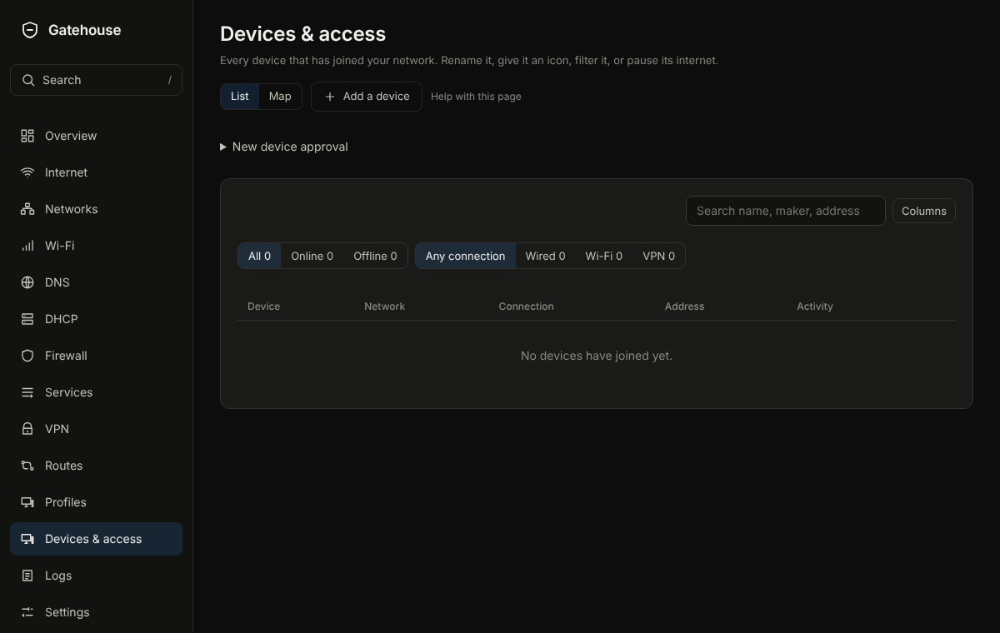
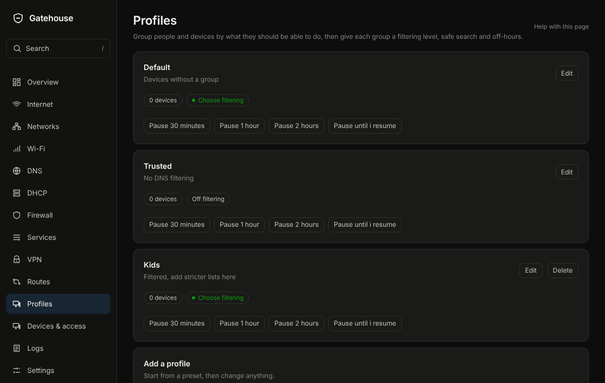

# Devices & access

## What it is for
Every device that has joined your network. Rename it, give it an icon, put it in a profile, or pause its internet.

The picture is an example from a new, empty box; yours will show your own devices and numbers.

## What is on the page
- **Search devices** and a **List** or **Map** view. **Columns and rows** chooses what the table shows.
- Each row shows the device, its network, how it is connected and whether it is allowed online. A button on the row pauses or resumes it; an offline device has **Forget**.
- Open a device to change its **Name**, **Icon**, **Profile**, **DNS filtering**, **Notes** and **Fixed address**, or **Pause the internet** for a set time. **Allowed online** turns it off without losing its settings. For a device on a VPN there is also **Sent through** and a Check. The panel also lists **Firewall rules that mention it**.
- **Add a device** records one that has not joined yet.

## Common tasks
1. Pause a device: press its row button, or open it and choose a pause length. **Resume now** brings it back.
2. Rename a device: click it, type the name, press Enter.
3. Keep a device at the same address: open it, turn on **Fixed address**.

4. Let the internet reach an app on a device: press **Open a port** on its row, tap the app, done. Then **Review and apply** at the bottom.

## Example
Pause the games console for two hours at homework time: open it and choose the two-hour pause. It comes back by itself.

## If something goes wrong
A device missing from the list has not joined yet, or has not asked NopeWarden for an address. Use **Add a device** to record it. If a name is wrong, rename it; the old name is only a guess from the network.

## Profiles (a tab of Devices & access)
**What it is for**
A profile decides which blocklists apply to a device and when the internet is off for it, such as a Kids profile.

The picture is an example from a new, empty box; yours will show your own devices and numbers.

**What is on the page**
- **Profiles**: each with a **Name**, **How much to filter**, **Safe search**, and **Internet off at set hours** (**Off from** and **Back on at**). **Pause…** is one drop-down on each profile: it stops the internet for that profile's devices for a while, and **Resume now** undoes it. The device count shows only that profile's devices on the Devices tab.
- **Advanced: pick block lists** (in the profile's edit window) lets a profile use extra block lists from the DNS Blocking tab, on top of its filtering level. This is where the DNS page's old Profiles tab went; there is now one place to edit a profile.
- **Add a profile**: start from **Blank profile**, **Basic** or **Enhanced**, then change anything.
- **Filtering per network**: choose a profile for a whole network. Devices that have a profile of their own keep theirs.

**Common tasks**
1. Pause a profile: open **Pause…** on the profile and choose how long.
2. Make a Kids profile: under **Add a profile**, choose the **Kids** preset, name it, set the hours, **Save**.
3. See the devices in a profile: choose the device count on the profile. **Devices & access** opens with only those devices.
4. Put a device in a profile: on **Devices & access**, open the device and choose its **Profile**.

**Example**
Kids: **Enhanced** filtering, **Safe search** on, internet off from 21:00 to 07:00.

**If something goes wrong**
Deleting a profile moves its devices back to the Default profile. Safe search works for browsers that use NopeWarden for DNS; turn on forced DNS for devices that do not.
