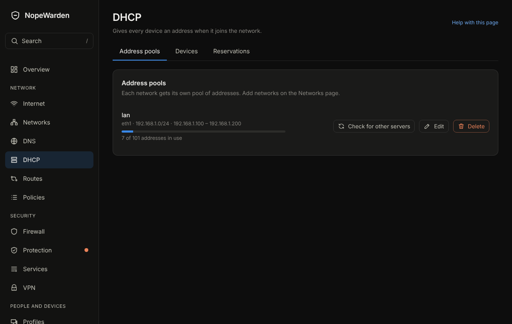

# DHCP

## What it is for
DHCP gives every device on a network an address when it joins. NopeWarden does this for you.

The picture is an example from a new, empty box; yours will show your own devices and numbers.

## What is on the page
- **Address pools**: one per network, with **First address to give out**, **Last address to give out**, **Gateway**, **DNS server**, **How long an address is kept** and **Home domain**. **Who hands out addresses here?** is **NopeWarden**, **Another router, relayed to NopeWarden**, or **Another device (NopeWarden stays out of it)**. **Check for other servers** listens for a second DHCP server, which causes trouble.
- **Devices with an address**: every device that has one now, with **Reserve** and **Release**.
- **Reserved addresses**: devices that always get the same address. **Add reservation** takes the device address (MAC) and the address to keep.

## Common tasks
1. Keep a printer at the same address: find it under **Devices with an address**, press **Reserve**.
2. Change the range: edit the pool and change the first and last address.
3. Make a pool for a new network: add the network on the Networks page first; it appears here.

## Example
Reserve 192.168.1.20 for the printer, then use that address in a firewall rule or port forward.

## If something goes wrong
If devices get addresses you did not expect, **Check for other servers** can show another router handing out addresses. Turn that one's DHCP off.
