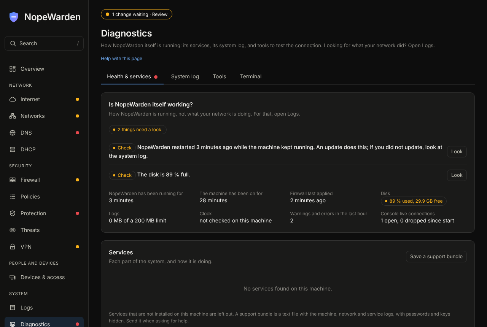
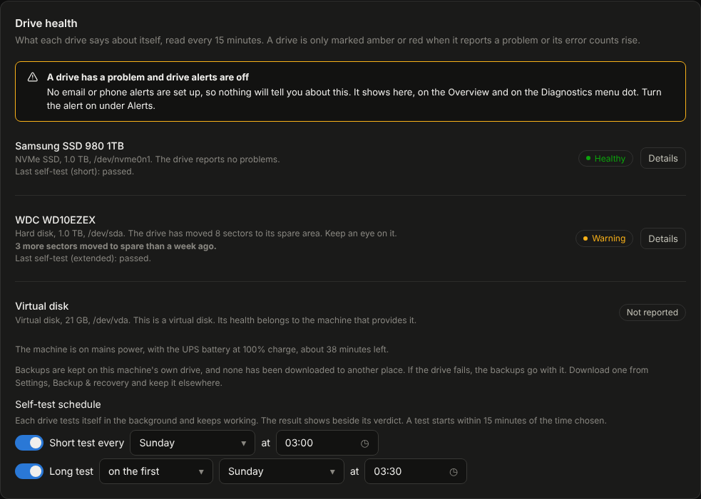
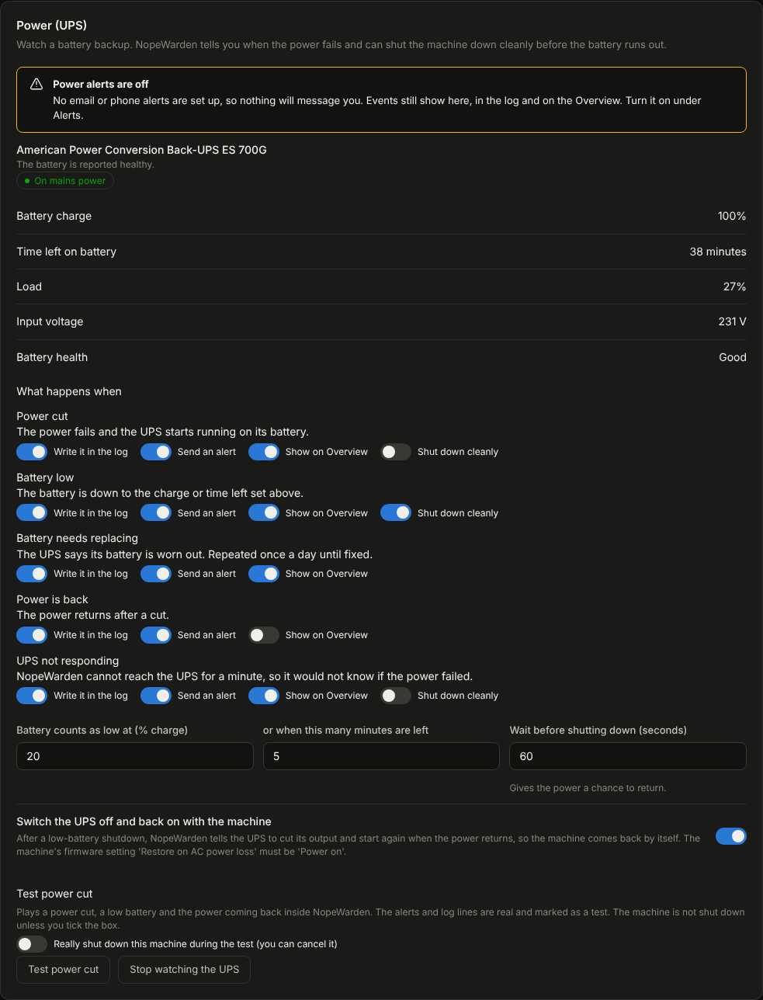
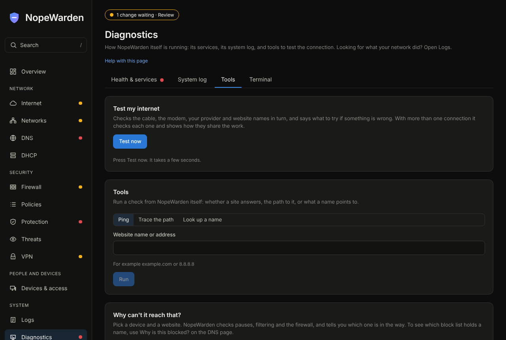

# Diagnostics

## What it is for
Diagnostics answers one question: is NopeWarden itself working? It shows how each part is doing, lets you read the system log, tests the connection, and, if you switch it on, gives you a command line on the firewall. It is for the day something is wrong and there is no screen or keyboard on the machine.

The picture uses made-up devices and numbers. Yours will show your own.

## What is on the page
- **Health & services** is the first tab and the one you will use most. The card at the top, **Is NopeWarden itself working?**, gives one sentence: **Everything is working.** or how many things need a look. Problems come first, each with a **Look** button that opens the right place. Below that are a few facts: how long NopeWarden and the machine have been running (a restart you did not expect stands out), when the firewall rules were last applied, disk and log space, whether the clock is set, and warnings in the last hour.
- **Find traffic** shows what became of the connections between two places.
- **System log** shows messages from NopeWarden and the machine.
- **Tools** holds the tests for when something is not reachable.
- **Terminal** is a command line on the firewall.

## Health & services
Under the facts is **Services**: each part of the system with its state, Running, Starting, Failing or Off. A failing one says why in plain words. **Show log** opens its log and **Restart** restarts it. **Save a support bundle** saves a text file with the machine, the network, every service's state and recent log lines. Anything that looks like a password or key is hidden in it. Send it when you ask for help.

**Console connections** records the live connection your browser keeps open to the console: one row for each visit, with when it opened, from which address, how long it lasted and why it ended. The latest 5 show; **Show older** lists the rest. **What is using the disk** lists the biggest places on the disk, three at first; **Show all** lists the rest.

**Certificates** lists the days left on each VPN authority, server and user certificate, and on the link between two machines in a pair. A certificate turns blue about 60 days out, amber inside 30 days, and red once it has run out. The console's own certificate shows only in its last 30 days, because it renews itself.

**My network**, at the bottom, is a printable summary with a map, for a handover or your own records. It never contains passwords or keys.

## Drive health
Each drive gets one word: **Healthy**, **Worn**, **Warning** or **Not reported**. A drive turns amber or red only when it reports a problem or its error counts rise. A worn-out drive is blue first. **Details** opens a box with everything the drive said, and a line listing what this hardware did not report. A virtual disk says so, because its health belongs to the machine that provides it. If the small SMART program is missing, **Install the SMART tool** installs it.

NopeWarden also watches over time. Every 15 minutes it notes each drive's sectors moved to spare, sectors waiting, cable errors, media errors and wear, and says in plain words when one has risen, for example "3 more sectors moved to spare than a week ago". These turn the drive amber or red, show on the Overview list and the Diagnostics menu dot, and send the alert **A drive has a problem** if you have it on:
- a count that has risen,
- a drive that was there and has gone,
- a drive that starts reporting a problem,
- disk errors in the system log.

When that alert is off and a drive has a problem, the card says so, so you know nothing will tell you away from the screen.

The **Self-test schedule** under the drives sets when each drive tests itself. By default that is a short test every Sunday at 03:00 and a long one on the first Sunday of the month at 03:30. Inside **Details**, **Run a short self-test** and **Run a long self-test** start one now. The last result shows beside the verdict.

A line under the list says whether a backup has been downloaded to somewhere other than this machine's own drive. If the drive fails, backups kept only on it go with it.

## Power (UPS)
A UPS is a battery backup, such as an APC, on a USB cable or on the network. **Set up UPS monitoring** installs the small UPS program and starts watching.

The card shows the model, **Battery charge**, **Time left on battery**, **Load**, **Input voltage** and **Battery health**. Under **What happens when**, each of **Power cut**, **Battery low**, **Battery needs replacing**, **Power is back** and **UPS not responding** has its own switches: write it in the log, send an alert, show on Overview and, where it makes sense, shut down cleanly.

- A low battery shuts the machine down cleanly after the wait you set. If the power comes back first, the shutdown is cancelled. **Cancel the shutdown** stops one that is waiting.
- **Switch the UPS off and back on with the machine** tells the UPS to cut its output and start again when the power returns, so the machine comes back by itself. For that to work, the machine's own setting "Restore on AC power loss" must be "Power on". NopeWarden cannot change that setting.
- **Test power cut** plays a power cut, a low battery and the power coming back, with real alerts and log lines marked as a test. The machine is not shut down unless you tick the box.
- **Stop watching the UPS** switches monitoring off.
- The alert is called **The power fails (UPS)**. Alerts are off until you switch one on under Alerts.

## Find traffic
Say where a connection came from and where it went, and see what became of it: whether it was allowed or blocked, which rule decided, and whether the other side answered. It is the page to open when you have just made a rule and want to know if it works.

Fill in **From** and **To** (either can stay empty). A box takes a device name, an address, a network name such as Guests, or a range such as 192.168.20.0/24. **To** also takes a website name, or a port after a colon, such as 8.8.8.8:53. **Port (optional)** narrows it to one port. Choose **When**: 15 minutes, an hour, 24 hours or **Live**. Choose **Result**: anything, allowed, blocked or no reply. Then press **Find traffic**.

A plain sentence on top says what was found, and there is one row for each connection: when it started, from, to, service, the rule that decided it, the result in words, the bytes sent and received, and how long it lasted. The results are **Completed**, **Still open**, **No reply** (it was let through but the other side never answered, so look at the far end and not at the firewall), **Reset** and **Blocked**.

**Live** starts at the moment you press **Start watching**. New connections appear at the top, and a row that was **Waiting for reply** changes to its result in place. **Pause** holds the list, **Clear** empties it, and it keeps the newest 200. It stops by itself after 10 minutes, so it cannot run forever, and **Keep watching** carries on.

Choose **Open now** above the results to see the connections the firewall is following at this moment, busiest first. **End this connection** removes one from that list, so the next packet is treated as a new connection and meets today's rules. It does not block anything by itself. It needs the conntrack tool, which is part of new installs.

Things worth knowing. A connection that was already open when the rules last changed keeps working under the old rules, so those rows say **Open before your change**; end them, or start the connection again, to test the new rules. Blocked connections are recorded at up to about 20 a second, so in a flood some are skipped and the blocked count is a floor. Allowed connections are only listed while recording of allowed connections is on (Logs, Settings), and how a connection ended is only tracked for IPv4 TCP and UDP.

**Trace this** in a Logs row, **Trace this device's connections** on a device, and **Test it live** after you apply a change all open this page filled in.

## System log
Only warnings and errors show until you tick **Everything**. Choose **From** (everything, or one service), **Time**, and **Search**. Every word you type must appear, the box looks through up to 5000 lines, and the words are highlighted. **Follow** refreshes every 5 seconds. Known messages get a plain explanation next to them.

## Tools

The picture uses made-up devices and numbers. Yours will show your own.

**Test my internet**, ping, traceroute and name lookups are here, and so is **Why can't it reach that?** for one device and one site. **DNS check** is here too. These are the only copies, so Internet, Troubleshoot points here. Use **Report on this link** to open a report for the connection you are testing.

## DNS check
Pick a device in **DNS check** to see whether it uses NopeWarden's DNS, or also talks to a DNS server on its own, which skips your block lists. It looks at the last 24 hours of that device's lookups and connections. The verdict is one of: **Uses NopeWarden's DNS**, "Also talks to a DNS server directly" (with who, how many connections and about how often), "Tried to skip NopeWarden's DNS and was stopped", or "Not sure" (with the reason).

Each server it finds says how it was recognised, so a guess is never passed off as a fact. **On the known list** means a well-known public service such as Google, Cloudflare or Quad9. **Probably a DNS server** means the device looked up a name that belongs to a DNS service just before connecting, or the address resolves back to one. **DNS port** means port 853 or 53 was used. **Confirmed DNS server** means an actual DNS question was answered.

Press **Check this address** to confirm one. NopeWarden then connects to that server, asks one DNS question over HTTPS and one over TLS, and reads the name on its certificate. It never does this by itself, because it connects to someone else's server. The page also lists what the check cannot see, such as servers that insist on an exact name, and connections kept open for hours. A device that skips your DNS also gets a **Skipping your DNS** line on its panel in Devices.

## The terminal
A terminal is a full command line with the highest rights on the machine. Anyone who can sign in as an administrator and pass the check can do anything on it, so NopeWarden is careful:
- It is off until you switch it on, and only administrators can use it.
- Switching it on asks for your password, or your authenticator code if you use one. Opening it asks again only if the last check was more than 15 minutes ago.
- It closes by itself when nobody has typed for 10 minutes, and after two hours at most. Two can be open at once.
- Logs record who opened it, when, from where, and when it closed. What is typed is not recorded.
- It cannot hold up your traffic by itself. If you break something from it, that is down to the command you typed.

## Common tasks
1. Find out why a service is not working: **Health & services**, read the reason, press **Show log**.
2. Restart a service that is stuck: **Restart**.
3. Get help: **Save a support bundle** and send the file.
4. Run a command by hand: **Terminal**, **Switch the terminal on**, enter your password or code, then **Open a terminal**.

## Example
The internet feels slow. Open **Tools**, press **Test my internet**, and read what it says about the cable, the modem and your provider. Then open **Health & services** to see whether any service is failing.

## If something goes wrong
If a service shows **Failing**, read its reason and its log. The reason is the last line it printed that looked like an error. If the page shows nothing, you may not be signed in as an administrator. If the terminal will not open, check that it is switched on and that two are not already open. If it stops responding, **Close the terminal** and open a new one.
