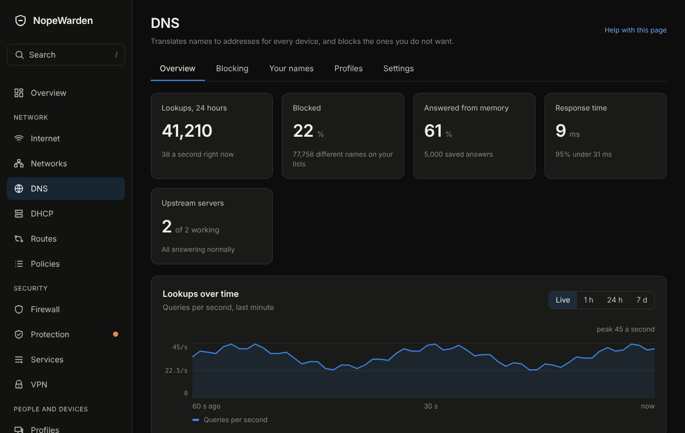

# DNS

## What it is for
DNS turns names into addresses. Gatehouse answers for your devices, blocks ads, trackers and malware names, and lets you add your own names.

The picture is an example from a new, empty box; yours will show your own devices and numbers.

## What is on the page
Tabs along the top:
- **Overview**: **Lookups over time**, **How queries were answered**, **Busiest devices**, **Most blocked** and **Most asked**.
- **Blocking**: **Blocklists** you can switch on, **Always allow or block** exceptions that beat every list, and **Why is this blocked?** to find which list blocks a name.
- **Servers**: **Upstream DNS servers** (where Gatehouse asks when it does not know), **Which server is asked first**, **Add a DNS server**, and the encrypted DNS switch.
- **Your own names**: **Give this firewall a name**, and names that point somewhere on your network, like nas.lan to 192.168.1.10.
- **Profiles**: **Filtering profiles**, which lists apply to which devices.
- **Settings**: **What to do with blocked names**, **Home domain**, **Queries per second per device**, **Remember answers (entries)**, **Keep the query history for (days)**, **Hide device addresses in the history** and **Tell browsers to use this DNS**.

Devices sent through a VPN have their name lookups sent through it as well.

## Common tasks
1. Allow a blocked site: **Always allow or block**, type the name, choose allow, **Add**.
2. Find out why a site is blocked: **Why is this blocked?**, type the name, **Check**.
3. Name a device on your network: **Your own names**, enter the name and address, **Add**.

4. Block an app, a topic or a website for one device, a network or at set hours: this is on the Protection page now, under **Apps & topics**.
5. See what a list blocks: **Blocking**, **View names** on the list. Search, and allow a name that should not be blocked.

## Example
A shopping site does not load. Type its name under **Why is this blocked?**; it names the list. Add the name to **Always allow or block** as allowed.

## If something goes wrong
**No server is answering** under Servers means none of the upstream servers replied. Check the internet. **Clear saved answers** forgets everything Gatehouse remembers and is safe to use.
