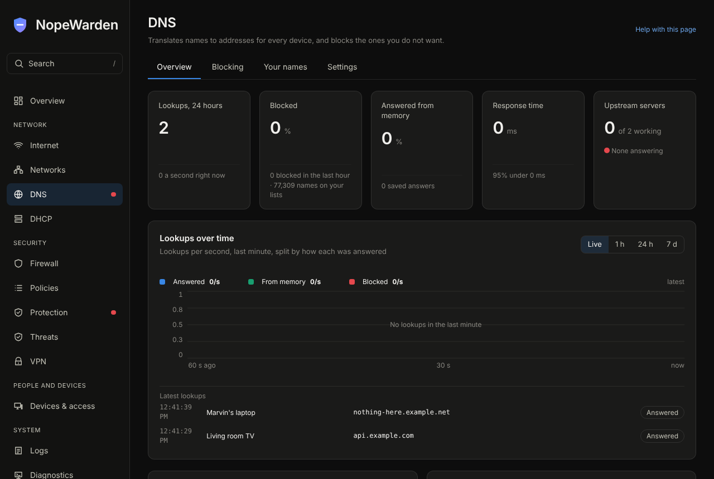
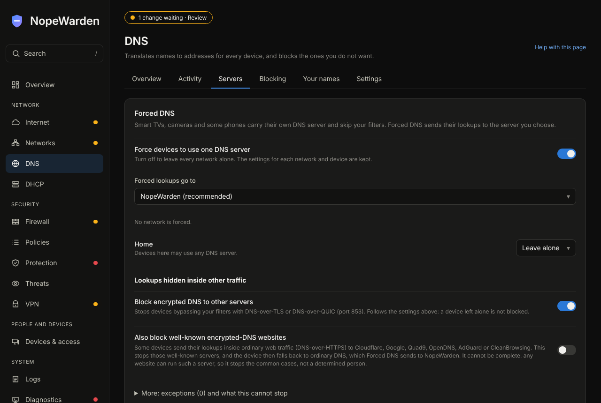
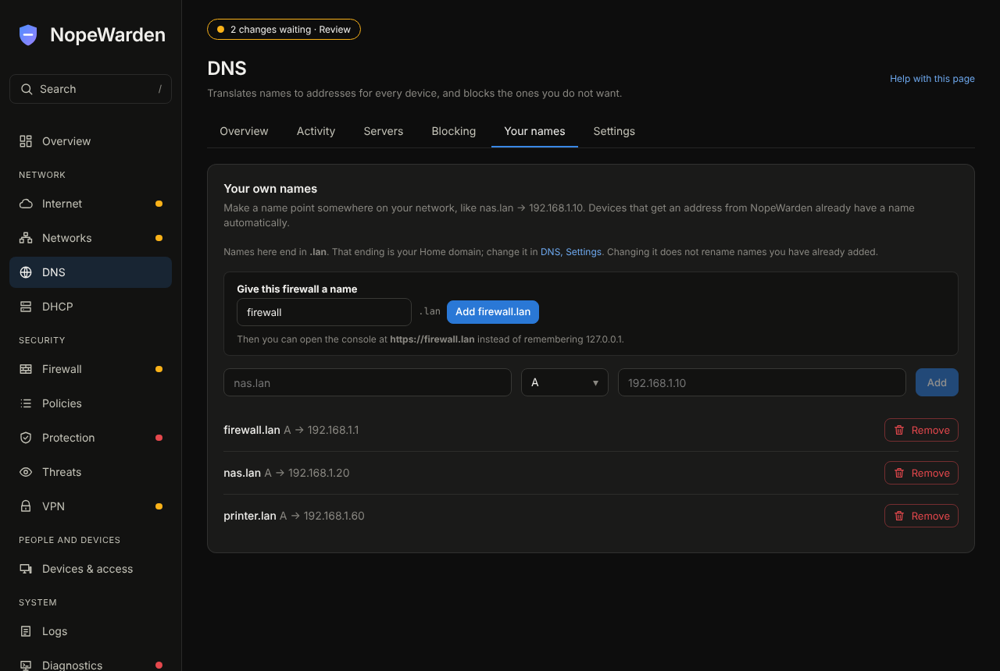

# DNS

## What it is for
DNS turns names into addresses. NopeWarden answers for your devices, blocks ads, trackers and malware names, and lets you add your own names.

The picture uses made-up devices and numbers. Yours will show your own.

## What is on the page
Tabs along the top:
- **Overview**: **Pause blocking…** at the top (see below), then number cards, each with a small 24-hour chart that has a scale on the left and times along the bottom (select one to open the page that explains it), **Lookups over time** (Live shows the last minute and the latest lookups; 1 h, 24 h and 7 d show history), **How queries were answered**, **Answer time** and **What changed**.
- **Activity**: who asked and what was stopped, for the last hour, 24 hours or 7 days: **Busiest devices**, **What blocked it**, **Most blocked** and **Most asked**.
- **Servers**: where names are looked up (picture below). **Upstream DNS servers** (where NopeWarden asks when it does not know), **Names that use a different server** (see below), **Which server is asked first**, **Add a DNS server**, **Encrypted DNS**, **Encrypted DNS for your devices** (see below), **Resolve directly** and **Forced DNS**. Forced DNS sends devices that carry a DNS server of their own (smart TVs, cameras, some phones) to the one you chose. Turn **Force devices to use one DNS server** on, pick the server, then set each network and add exceptions for chosen devices or groups. It redirects ordinary DNS only: a device that hides its lookups inside normal web traffic (DNS-over-HTTPS) can still go around it.
- **Blocking**: **Ad, tracker and malware lists** you can switch on (which devices get which lists is set per profile, on the Profiles tab of Devices & access), **Always allow or block** exceptions that beat every list (a name, or a pattern that matches many names), and **Why is this blocked?** to find which list blocks a name.
- **Your own names**: **Give this firewall a name**, and names that point somewhere on your network, like nas.lan to 192.168.1.10. A line under the heading says names end in your Home domain and links to **DNS, Settings** to change it. Each name is shown in full, with the Home domain ending (for example printer.lan).
- **Settings**: **What to do with blocked names**, **Home domain**, **How long devices remember a blocked answer (seconds)**, **Queries per second per device**, **Remember answers (entries)**, **Keep the query history for (days)**, **Hide device addresses in the history** and, under **Apps that skip your DNS**, **Tell browsers to use this DNS** and **Block iCloud Private Relay**.

Devices sent through a VPN have their name lookups sent through it as well.

## Common tasks
1. Allow a blocked site: **Always allow or block**, type the name, choose allow, **Add**.
2. Find out why a site is blocked: **Why is this blocked?**, type the name, **Check**.
3. Name a device on your network: **Your own names**, enter the name and address, **Add**.

4. Block an app, a category or a website for one device, a network or at set hours: use **Blocks** on the Protection page.
5. See what a list blocks: **Blocking**, **View names** on the list. Search it, and allow a name that should not be blocked.
6. Allow or block a site straight from a lookup you can see: open Logs, find the DNS row, and use **Allow this site** or **Block this site**. You choose the name or the whole site, and who it applies to (everyone, that device, its network, its profile, or your own mix). The window names the list that blocks it and warns you before you allow something on a threat or malware list. The change waits on Review like other DNS changes, shows on the Blocks page marked "added from Logs", and the pop-up that appears afterwards has an **Undo** button.

## Example
A shopping site does not load. Type its name under **Why is this blocked?**; it names the list. Add the name to **Always allow or block** as allowed.

## If something goes wrong
**No server is answering** under Servers means none of the upstream servers replied. Check the internet. **Clear saved answers** forgets everything NopeWarden remembers and is safe to use.

## Resolve directly (your own resolver)
Under **Servers**, **Resolve directly** turns on NopeWarden's own Unbound resolver. Instead of asking a forwarder such as your provider or Cloudflare, it asks the internet's root servers itself, so no single company sees every name you look up. It is off until you turn it on, and it only listens inside the box (port 5335), never on your network.

- While it switches on, the card says what it is doing (setting up Unbound, waiting for its first answer, switching your devices over) and the choice is locked; it can take up to a minute. If it cannot be done, the message says why and your lookups stay as they were.
- It works on a fresh install: the key Unbound uses to check signatures (the DNSSEC root key) is put in place for you when you first turn it on. If it cannot be, the message says so in plain words and your name lookups stay as they were.
- **Check DNSSEC**: names signed with DNSSEC are verified. When a check fails, the query log says why in plain words (for example, the site's signature has expired) rather than just failing.
- Automatic fallback: if direct lookups stop working, NopeWarden switches to your encrypted forwarders by itself and raises an alert. It switches back when direct lookups work again.
- **Your own names** keep working (split-horizon): names you define, like nas.lan, are answered locally and never sent out.

## Changes wait for Review
DNS changes (lists, servers, your own names) wait on the **Review changes** page along with firewall and network changes. You apply or discard them together, and **Discard** puts DNS back exactly as it was running.

## Schedules
Blocklist refreshes follow the one schedule editor (every N hours, daily, weekly or off). A failed refresh retries after 5 minutes, then 15, 30 and every hour.

## DNS follows the route
A device sent through a VPN or a particular internet connection looks up names through that same path, so a website route never leaks lookups to your normal connection. The Routes tab on Policies lists the addresses learned for each website route.

## Pausing blocking
A page will not load and you wonder whether blocking is the reason. On the DNS Overview, choose **Pause blocking…** and pick 5 minutes, 30 minutes, 1 hour or until you resume. For that time every name is let through: your lists, your own blocks, and the app and category blocks. Then try the page again. If it loads, blocking was the cause, and **Why is this blocked?** will name the list.

Blocking starts again by itself when the time is up, or at once if you choose **Resume now**. A banner on the DNS page and a line on the Overview remind you while it is paused, the pause is written to Admin activity, and it lasts through a restart. Safe search and your own names keep working.

## How long devices remember a blocked answer
When a name is blocked, the answer NopeWarden gives is kept by the device for a short time, 60 seconds unless you change it. After you allow a name, a device may take that long to try it again. A low number notices changes sooner. Most people never change it. The setting is in **DNS, Settings**.

## Apple's Private Relay
**Block iCloud Private Relay** is off until you turn it on. Private Relay lets iPhones and Macs hide where they go from your network, so your logs, your blocks and your profiles cannot see it. With the switch on, NopeWarden answers the names Apple tells networks to refuse, and each Apple device tells its owner that Private Relay is off on this network. It works again on any other network.

## Newly registered domains
Scam and phishing sites are often brand new. On **Blocking**, **Add list** has a one-tap choice for **Newly registered domains (7 days)**, which blocks websites registered in the last 7 days. It is off until you add it. Honest new sites are caught too, so allow any you trust under **Always allow or block**; an allow always beats a list. The list is large, about 3 million names and about 250 MB of memory, and refreshes daily like the other lists. Choose which profiles use it under Devices & access, Profiles.

## Names that use a different server
Some names only one server knows, such as the computers on an office network or a company VPN. On **Servers**, **Names that use a different server** lets you say "names ending in office.example are asked of 10.0.0.2". Type the domain and the server's address, then **Add**. **Test** asks that server about the domain and says in words whether it answered, and whether it knows the domain.

Your own names (like nas.lan) and your blocks still come first, the answers are kept like any other, and every other name goes to your usual servers. Remove the line and the domain goes back to your usual servers. If the special server stops answering, only those names fail, and the Logs say which server was asked. Like other DNS changes, this one waits on **Review changes**.

## Patterns
A name rule also covers everything under it, so youtube.com covers music.youtube.com. When you want to catch many names with one rule, choose **A pattern** in **Always allow or block**. A pattern is matched against the whole name. A star stands for any run of letters, digits, dots and dashes, and a question mark for one of them, so ads*.example.com catches ads1.example.com and ads-eu.example.com but not www.example.com.

Type a name in **Try a name** to see whether the pattern catches it. Below that NopeWarden shows which of the names your devices asked in the last day it would have caught, before you save anything. A pattern that is written wrongly is explained in words, and a pattern that would match almost every name is refused. An allow always beats a block, and an allow on a plain name beats a pattern. Each block shows how many lookups it stopped in the last day.

People who know regular expressions can open **More options** and turn on **Use a regular expression instead**. They are checked in the same way, and they cannot slow DNS down however they are written.

## Encrypted DNS for your devices
Away from home, or on a network you do not trust, a phone can ask this firewall for names over an encrypted connection so nobody on the way can read them, and your lists and logs still apply. On **Servers**, turn on **Encrypted DNS for your devices**, choose the networks that may use it, and **Save**. It is off until you do, and a port that faces the internet can never be chosen.

The card shows what to type on a device: an address with port 853 (DNS-over-TLS) or a web address ending in /dns-query on port 8443 (DNS-over-HTTPS). NopeWarden makes its own certificate, and a device accepts it only if you install it there. To use Android’s Private DNS without warnings, choose **Upload a certificate** and give a certificate and key your devices already trust, for a name that points at the firewall. **Use NopeWarden’s own** puts the original back. This is separate from **Encrypted DNS** above it, which is how the firewall itself asks the internet.
