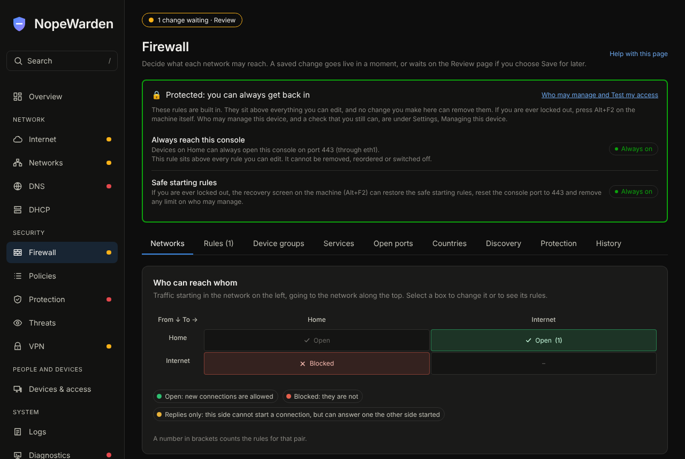
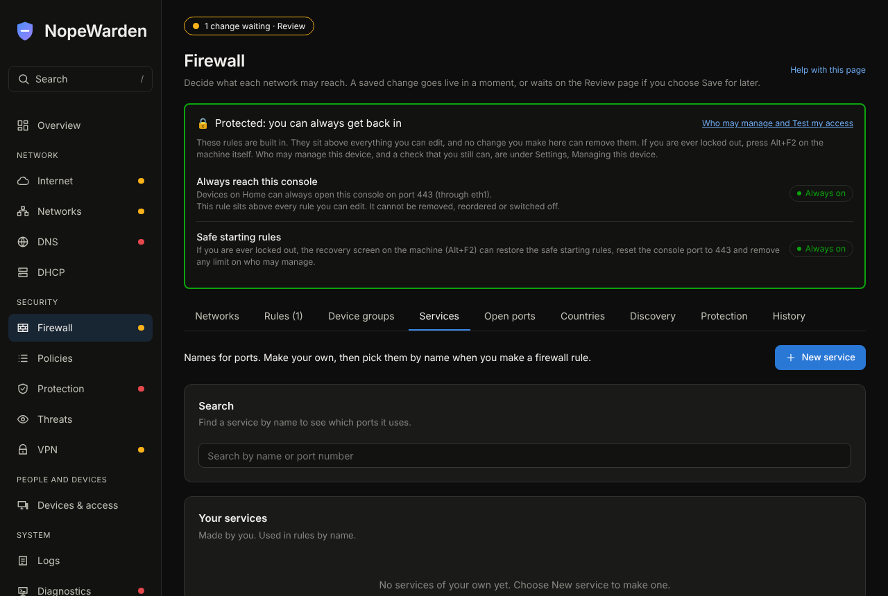

# Firewall

## What it is for
The firewall decides what each of your networks may reach, and lets you add exceptions. The type of each network does most of the work, in plain terms.

The picture uses made-up devices and numbers. Yours will show your own.

## What is on the page
Tabs along the top:

- **Networks** starts with **Who can reach whom**, a grid of every network against every other. Select a box to change it or to see its rules. Under it, **Your networks**, each with a type. For each one you can set **Can reach the internet**, **Devices here can talk to each other** and **Can manage NopeWarden**, and under Advanced **NopeWarden is the gateway**, **Make devices here use the enforced DNS server** and **Allow remote login (SSH)**. **Test my access** shows whether a device can reach something. **In plain words** says what the firewall does right now.
- **Rules** holds your own rules (see below).
- **Device groups** are named groups of devices to use in rules, such as Media players. A group is only a shortcut for rules. To filter devices or switch their internet off at set hours, use Profiles under Devices & access.
- **Services** are names for ports, to pick in rules (see below).
- **Open ports**: **Open a port** lets something outside reach an app on one of your devices, like Plex or a game server. Each one can be paused, put on a schedule, turned off, edited or removed, the same way as a rule. A paused rule or port is closed until the time runs out or you press **Resume now**. The change waits for **Review and apply** like any other.
- **Countries** blocks or allows whole countries.
- **Discovery** lets devices on different networks find each other, such as casting and printers.
- **Protection** holds **Block encrypted DNS to other servers**, **Also block well-known encrypted-DNS websites**, **Ask for a code before changing the firewall** and **Log blocked traffic**. Forced DNS is on the DNS page, under Servers.
- **History** has **Change history**: every time the firewall was changed and whether you kept it.

The box at the top of the page, **Protected**, lists the rules that always let you get back in. The management port and who may manage this device live under Settings, Managing this device, because they are settings of the machine, not of the firewall. The firewall rules they need are still made for you.

## Rules
**Rule lines** shows one row for each rule: its number (the order they are checked), name, From, To, Service, Action, **Matches** and When. Long lists show the first two and +N for the rest. Click a row to open it. You see the rule in a sentence, its counts, and **Up**, **Down**, **Pause…**, **Turn off**, **Edit** and **Remove**. A rule with several services shows how often each one matched.

- Rules that are built in open for reading only, and so do the ones other pages make. Paused devices, for example, lists who is blocked and has a button to Profiles.
- **Plain cards** is the older view, with a sentence for each rule. Narrow windows open on it, and the view you choose is remembered.
- **Live** (on by default) refreshes the counters every second or two and flashes a row the moment it matches, so you can see whether a rule is really being hit. With it off, the counters refresh about every 20 seconds.
- **Export what is shown (CSV)** saves the rows on screen, after your search and filters, with one row for each service.
- Each rule has **Pause…** (for a set time, or until you resume it), **Turn off**, **Edit** and **Remove**, the same controls that routes, blocks and port forwards have. Deleting one can be undone for a few seconds.
- **Create policy** on the Policies page opens this form for you too.

A rule is marked Duplicate, Not needed or Never applies, with a warning line, when an earlier rule already covers it: it is the same as that rule, or that rule already does the job, or that rule decides the other way so this one never applies. Nothing is changed for you. Remove the extra rule or move it above the other.

**Paused** (under "Set on other pages") is the rule that blocks paused devices from the internet. It is greyed out and says **Standing by, nobody paused** until you pause a device or a profile on the Profiles page. After that it shows who is blocked.

## Always on
At the bottom of the Rules tab, closed until you press **Show**, are the seven things NopeWarden does before it looks at any rule of yours:
- dropping broken connections,
- letting replies back in,
- limiting ping to this box,
- letting devices ask for an address and for names,
- letting the IPv6 and error messages through,
- refusing encrypted DNS sent to this box so apps fall back quickly,
- dropping everything else.

Each has a plain reason and a count of the packets it has handled. They cannot be changed.

## Letting devices open ports (UPnP)
**Let devices open ports by themselves (UPnP)** lets a game console or media app ask for a port instead of you opening it by hand. It opens that port for that device only. It is off until you switch it on. Turn it off if you want every open port to be your own choice.

## Services
A service is a name for one or more ports, such as "plex" for tcp/32400. Rules pick services by name instead of by number.

- **Search services**: type a name or a port.
- **Your services** are the ones you made, with **New service**, **Edit** and **Delete**. Deleting one can be undone for a few seconds, unless a rule uses it.
- **Built in** names are ones NopeWarden already knows. They cannot be changed. The list is folded to keep the page short. The line beneath it, which says how many there are, opens it, and typing in **Search services** opens it by itself.

To make a service, choose **New service** and give it a **Name**. Under **Ports** choose **Protocol** (TCP, UDP, **TCP and UDP**, or ICMP for ping), type a port or a range such as 27000-27050, and press **Add**. Each port appears in the list below, and ✕ removes one. A wrong entry is explained in words under the box. For a known name such as https use **add a known name**. For a long list use **paste a list**, one entry per line like tcp/32400. Then press **Save**.

To use it, type its name in the "What for" box of any rule or open port. Several can go in one box, separated by commas or spaces. To rename one, **Edit**, change the **Name** and **Save**. Rules and open ports that use it follow the new name. The built-in **console** service is this console itself, and it follows the console port, so it changes if you move the console to another port.

A service that a rule, an open port or a route uses cannot be deleted until that changes, and NopeWarden names the one in the way.

## Common tasks
1. Open a port for a game console: **Open ports**, **Open a port**, choose the app, choose the device, **Save**, **Review and apply**.
2. Open a port in three taps: **Open ports**, **Open a port**, tap the app, tap the device. NopeWarden tells you which port it used. If that is not the right port, choose **Change port** and enter it yourself. A port that is already in use is never picked for you. NopeWarden asks for a different one.
3. Stop a network reaching the internet: **Networks**, turn off **Can reach the internet** for it.
4. Allow one device to reach another network: **Rules**, add a rule, choose the device and the service.
5. See everything the firewall does: **Rules**, **Rule lines**. The built-in rules, the rules other pages make and your open ports are listed there too. In **Plain cards**, turn on **Show system rules**.
6. Check that a rule is working: leave **Live** on, then try the thing the rule is for. Its **Matches** count goes up and the row flashes.
7. Watch for infected devices and break-in attempts: that is on the **Threats** page. Blocking apps and categories is on **Protection**. Threat watching tells you in plain words. Only if you choose **Watch and block** does it also block outside addresses, for a short time, and if it stops, nothing is blocked and your traffic is not touched.

## Example
Open Plex for your media server: **Open a port**, choose Plex, choose the server, optionally limit it to your own country, **Save**, **Review and apply**.

For services, make "console-game" with udp/3074 and tcp/3074, then use it in a rule for your console.

## If something goes wrong
NopeWarden refuses a change that would leave you no way to manage it, and always keeps safe starting rules above everything you can edit. If a change breaks something, the 60-second way back puts it right.
