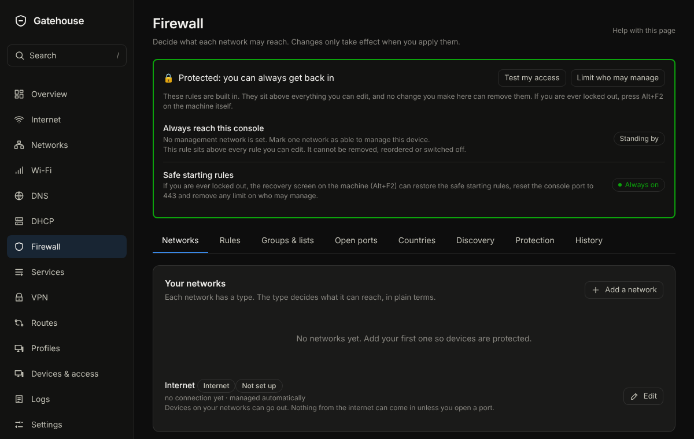

# Firewall

## What it is for
Decides what each of your networks may reach, and lets you add exceptions. The type of each network does most of the work in plain terms.

The picture is an example from a new, empty box; yours will show your own devices and numbers.

## What is on the page
Tabs along the top:
- **Networks**: **Your networks**, each with a type. For each: **Can reach the internet**, **Devices here can talk to each other**, **Can manage NopeWarden**, and under Advanced **NopeWarden is the gateway**, **Make devices here use the enforced DNS server** and **Allow remote login (SSH)**. **Test my access** shows whether a device can reach something. **In plain words** says what the firewall does right now.
- **Rules**: your own rules, each with a name, who, what and the action. Each rule has **Pause…** (for a set time, or until you resume it), **Turn off**, **Edit** and **Remove**, the same controls routes, blocks and port forwards have. Deleting one can be undone for a few seconds. **Create policy** on the Policies page opens this form for you too.
- **Groups & lists**: named groups of devices to use in rules.
- **Open ports**: **Open a port** lets something outside reach an app on one of your devices, like Plex or a game server. Each one can be paused, put on a schedule, turned off, edited or removed the same way as a rule. A paused rule or port is closed until the time runs out or you press **Resume now**; the change waits for **Review and apply** like any other.
- **Countries**: block or allow whole countries.
- **Discovery**: let devices on different networks find each other, such as casting and printers.
- **Protection**: **Block encrypted DNS to other servers**, **Also block well-known encrypted-DNS websites**, **Ask for a code before changing the firewall** and **Log blocked traffic**.
- **History**: **Change history**, every time the firewall was changed and whether you kept it.

## Common tasks
1. Open a port for a game console: **Open ports**, **Open a port**, choose the app, choose the device, **Save**, **Review and apply**.
2. Stop a network reaching the internet: **Networks**, turn off **Can reach the internet** for it.
3. Allow one device to reach another network: **Rules**, add a rule, choose the device and the service.

4. Open a port in three taps: **Open ports**, **Open a port**, tap the app, tap the device. NopeWarden tells you which port it used. If that is not the right port, choose **Change port** and enter it yourself. A port already in use is never picked for you: NopeWarden asks you for a different one.
5. See everything the firewall does: **Rules**, turn on **Show system rules**. Your open ports are listed there too.
6. Watch for infected devices and break-in attempts, and block apps and categories: watching for threats is on its own **Threats** page, and blocking apps and categories is on the **Protection** page, both in the left menu. It watches and tells you in plain words; it does not block threats. If it stops, your traffic is not touched.

## Example
Open Plex for your media server: **Open a port**, choose Plex, choose the server, optionally limit it to your own country, **Save**, **Review and apply**.

## If something goes wrong
NopeWarden refuses a change that would leave you no way to manage it, and always keeps safe starting rules above everything you can edit. If a change breaks something, the 60-second way back puts it right.

## Letting devices open ports (UPnP)
**Let devices open ports by themselves (UPnP)** lets a game console or media app ask for a port instead of you opening it by hand. It opens that port for that device only, and it is off until you switch it on. Turn it off if you want every open port to be your own choice.
