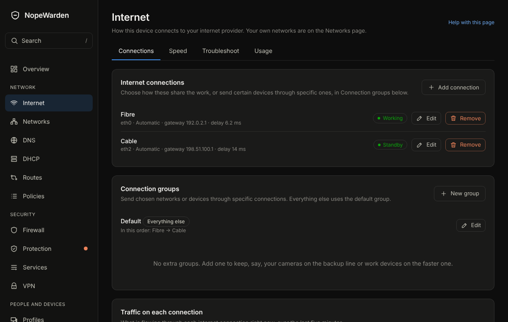

# Internet

## What it is for
Where your internet comes from: the cable from your modem, how your provider connects you, and what to do when it stops.

The picture is an example from a new, empty box; yours will show your own devices and numbers.

## What is on the page
Tabs along the top: **Connections**, **Speed**, **Speed control**, **Troubleshoot** and **Usage**. Warnings stay above the tabs, and the tab you pick is remembered. **Speed** appears once a connection is switched on; the last three are for administrators.

- **Connections**: **Internet connections**: one row per connection with its state in words (Working, No link, No internet), its port and its delay. **Add connection** adds a second one.
- **Edit** a connection to change its **Name**, the port the cable is plugged into, and **How does your provider connect you?** (**Automatic**, **Username and password**, or **Fixed address**). **Who is your provider?** fills in the usual settings for known providers. Advanced options include **VLAN number**, **IPv6**, **Check by**, **Order**, **Share of traffic** and **Packet size (MTU)**.
- **Speed**: **Speed test history**, **Test servers**, and **Keep delay low when the line is busy**, which stops one big download from slowing everything else. For each connection it shows three speeds: what the plan promises, the measured typical speed from the last 7 days of full tests on a quiet line, and the speed the queue is held to. **Follow my measurements** (the default once it is on) moves the held speed a little each day toward the measured one; **Use fixed numbers** holds it to the speeds you type. **Measure the line automatically** runs a test about every 4 hours, only when the line has been quiet for a minute. It says Learning until there are about 8 good tests over at least 2 days. **Check the difference** measures the delay under load without and with the queue and says in words what changed.
- **Speed control** holds a list of entries, each either **Limit speed** or **Give priority**, with a master switch, **Speed control is on**, that pauses all of them at once. An entry says who it covers (**Everyone**, or chosen networks, profiles and devices), what it covers (chosen apps, categories and websites, or everything when none are chosen) and when (**Always**, **Every day** or **Chosen days**). **Limit speed** takes a **Download limit (Mb/s)** and an **Upload limit (Mb/s)**, either of which can be left at 0, and is shared **All together** or given to **Each device**. **Give priority** is **High**, **Normal** or **Low**, and only matters when the internet connection is full; it works through the smart queue, so **Keep delay low when the line is busy** must be on for the connection. Apps, categories and websites are recognised by the names a device asks for, so an entry takes hold a moment after the device first asks. If something fails, nothing is slowed. The same entries appear on the Policies page as **Speed control**, and **Create policy** can start one.
- **Troubleshoot** holds **Test my internet**, **Tools**, and **Why can't it reach that?**. **Usage**: **Data use** shows what was used, for one internet connection or for **All connections**, over **This billing period**, **This month**, **Last month**, **Last 30 days**, **Last 7 days** or **Choose dates…** of your own, with the busiest devices on that connection. **Data limit** sets the plan's monthly allowance for one connection, the day its billing period starts and when to warn you; each connection has its own. The **Provider report card** keeps a month of outages and speed to show your provider.

## Common tasks
1. Add a second connection: **Add connection**, choose the port (NopeWarden notices a cable as you plug it in), choose how your provider connects you, **Save**, then **Review and apply**.
2. Change provider settings: **Edit**, change the type, **Save**, **Review and apply**.
3. Use two connections: give each an **Order** (1 is used first) or a **Share of traffic**.

4. Slow down a guest network: **Speed control**, **Limit speed**, choose the network under **Where it applies**, enter a **Download limit (Mb/s)**, **Save**, then **Review and apply**.
5. Keep video calls smooth while someone downloads: turn on **Keep delay low when the line is busy**, then **Give priority** to the category you want to go first.

## Example
Your cable modem needs nothing: choose **Automatic**. A fibre provider that needs a user name uses **Username and password**.

## If something goes wrong
**No link** means nothing answers on the cable: check the cable and the modem's power. **No internet** means the next device answers but nothing beyond it does: check your provider or restart the modem. A second connection takes over on its own.
