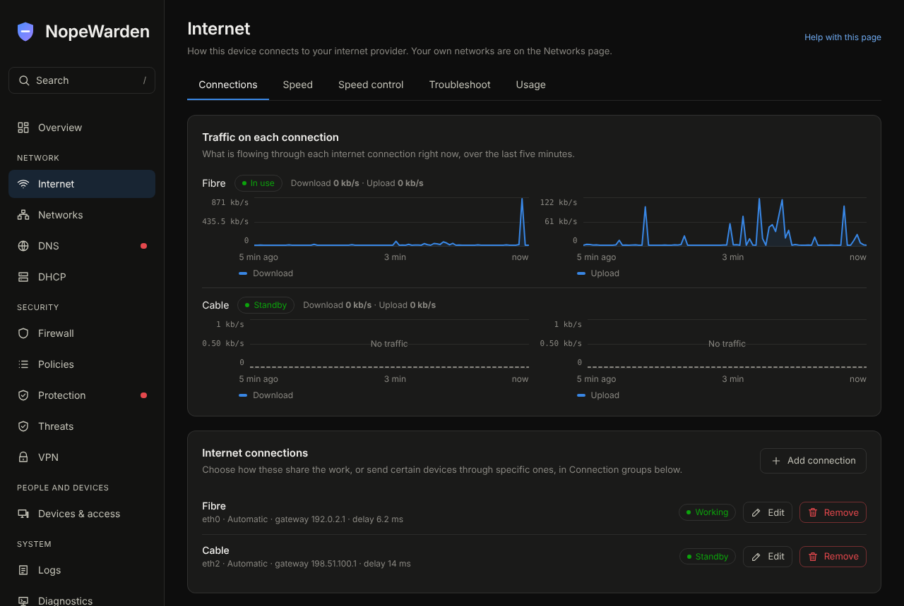

# Internet

## What it is for
Where your internet comes from: the cable from your modem, how your provider connects you, and what to do when it stops.

The picture uses made-up devices and numbers. Yours will show your own.

## What is on the page
Tabs along the top: **Connections**, **Speed**, **Speed control**, **Troubleshoot** and **Usage**. Warnings stay above the tabs, and the tab you pick is remembered. **Speed** appears once a connection is switched on. The last three are for administrators.

**Connections** starts with **Traffic on each connection**, which shows what is flowing through each one right now. Below it, **Internet connections** has one row per connection with its state in words (Working, No link, No internet), its port and its delay. **Add connection** adds a second one.

Choose **Edit** on a connection to change its **Name**, the port the cable is plugged into, and **How does your provider connect you?** (**Automatic**, **Username and password** or **Fixed address**). **Who is your provider?** fills in the usual settings for well-known providers. Advanced options include **VLAN number**, **IPv6**, **Check by**, **Order**, **Share of traffic** and **Packet size (MTU)**.

A connection and the port it uses share one name. If you name the connection T-Mobile, its port shows as T-Mobile on Networks, Firewall, the pickers and the logs. If you rename the port on Networks, the connection takes that name. The latest rename wins. A port that carries several connections, one for each VLAN, keeps its own name. A port with no name of its own takes its connection's name when NopeWarden is updated.

## Pausing a connection
**Pause** on a connection row, or **Pause all connections** above the list, stops traffic leaving through it for 30 minutes, 1 hour, 2 hours, or until you resume it. It shows as **Paused**. That is not treated as broken, so no outage alert goes out, but it stays on the Overview list so you do not forget it. **Resume** ends it early, and otherwise it starts again by itself.

- If another connection is working, it carries everything in the meantime.
- If not, the internet stops. The window tells you so and asks you to confirm with **Pause anyway**.
- It also warns you when you seem to be managing this device over the internet or a VPN, because pausing could cut you off.
- Only the way out stops. Your own networks, this console, DHCP and local names keep working.
- A pause acts at once, is written to Admin activity, and survives a restart. Port forwards that arrive through a paused connection keep answering.

## Speed
**Speed** has **Speed test history**, **Test servers** and **Keep delay low when the line is busy**, which stops one big download from slowing everything else.

For each connection it shows three speeds: what your plan promises, the typical speed measured over the last 7 days of full tests on a quiet line, and the speed the queue is held to.
- **Follow my measurements** (the default once it is on) moves the held speed a little each day toward the measured one.
- **Use fixed numbers** holds it to the speeds you type.
- **Measure the line automatically** runs a test about every 4 hours, but only when the line has been quiet for a minute. It says Learning until there are about 8 good tests spread over at least 2 days.
- **Check the difference** measures the delay under load without and then with the queue, and says in words what changed.

## Speed control
**Speed control** is a list of entries, each one either **Limit speed** or **Give priority**. A master switch, **Speed control is on**, pauses all of them at once.

An entry says who it covers (**Everyone**, or chosen networks, profiles and devices), what it covers (chosen apps, categories and websites, or everything when none are chosen) and when (**Always**, **Every day** or **Chosen days**).
- **Limit speed** takes a **Download limit (Mb/s)** and an **Upload limit (Mb/s)**. Either can be left at 0. The limit is shared **All together** or given to **Each device**.
- **Give priority** is **High**, **Normal** or **Low**. It only matters when the connection is full, and it works through the smart queue, so **Keep delay low when the line is busy** must be on for that connection.

Apps, categories and websites are recognised by the names a device asks for, so an entry takes hold a moment after the device first asks. If something fails, nothing is slowed. The same entries show on the Policies page as **Speed control**, and **Create policy** can start one.

## Troubleshoot and Usage
**Troubleshoot** is now just a pointer. **Test my internet** and **Why can't it reach that?** live in Diagnostics, on the **Tools** tab, and the pointer has a button that opens it.

**Usage** has two cards:
- **Data use** shows what was used, for one connection or for **All connections**, over **This billing period**, **This month**, **Last month**, **Last 30 days**, **Last 7 days** or **Choose dates…** of your own, with the busiest devices on that connection.
- **Data limit** sets the plan's monthly allowance for one connection, the day its billing period starts and when to warn you. Each connection has its own.

The **Provider report card** keeps a month of outages and speed that you can show your provider.

## Common tasks
1. Add a second connection: **Add connection**, choose the port (NopeWarden notices a cable as you plug it in), choose how your provider connects you, **Save**, then **Review and apply**.
2. Change provider settings: **Edit**, change the type, **Save**, **Review and apply**.
3. Use two connections: give each an **Order** (1 is used first) or a **Share of traffic**. When connections share the load, each new connection goes down one link, picked by the addresses and ports involved. One big download therefore uses one link, and the split only evens out over many connections, so it is rarely exactly the shares you set.
4. Slow down a guest network: **Speed control**, **Limit speed**, choose the network under **Where it applies**, enter a **Download limit (Mb/s)**, **Save**, then **Review and apply**.
5. Keep video calls smooth while someone downloads: turn on **Keep delay low when the line is busy**, then **Give priority** to the category you want to go first.

## Example
A cable modem needs nothing: choose **Automatic**. A fibre provider that needs a user name uses **Username and password**.

## If something goes wrong
**No link** means nothing answers on the cable, so check the cable and the modem's power. **No internet** means the next device answers but nothing beyond it does, so check with your provider or restart the modem. A second connection takes over on its own.
