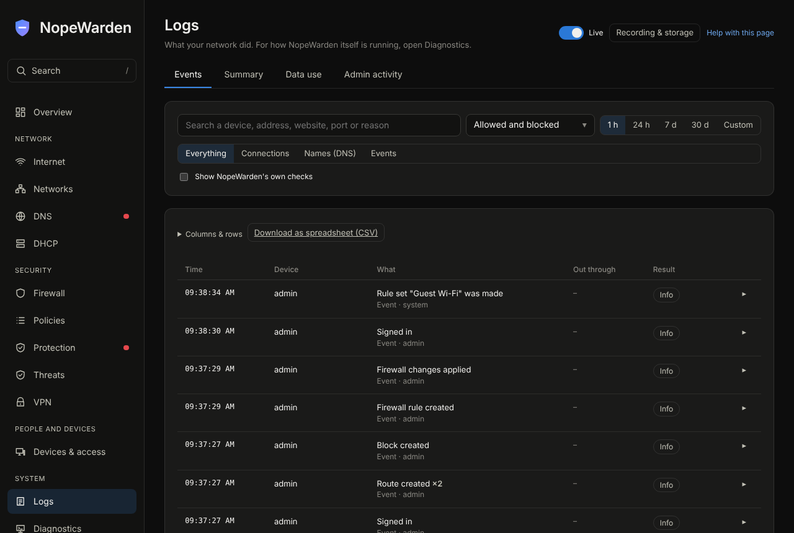
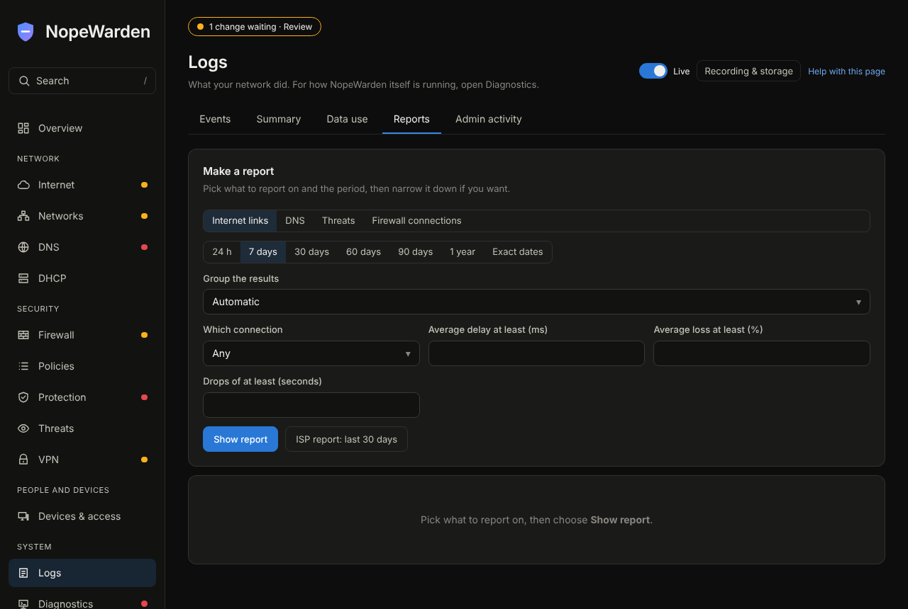

# Logs

## What it is for
What happened on your network and why: connections the firewall allowed or blocked, names your devices looked up, and changes.

The picture uses made-up devices and numbers. Yours will show your own.

## What is on the page
Tabs: **Events**, **Summary** (which has the full map), **Data use**, **Reports** and, for administrators, **Admin activity**.

Three places hold three kinds of log, so it helps to know which to open:
- **Logs** is what your network did.
- **Diagnostics** is how NopeWarden itself is running (its system log).
- **Admin activity** is who changed what in NopeWarden: sign-ins and failed attempts, and the changes people made, each with who, what, when and from which address. You can search with several words (each must match a person, an action or an address) and choose a time range. The count says how many match and how far back it searched.

### Events
- The search box and filters: **Allowed and blocked**, a time range (1 h, 24 h, 7 d, 30 d, or custom), and **Everything**, **Connections**, **Names (DNS)** or **Events**. Live updates can be turned off.
- Your search words are highlighted in each row. The search is part of the address (for example #/logs/log?q=printer), so you can bookmark it or send it to someone.
- Every row is at most two lines: the app or website on top, the port and service below. **Out through** shows which connection or VPN it left by. Identical neighbouring entries are folded into one row with a count.
- NopeWarden's own health checks are hidden. To see them, turn on **Show NopeWarden's own checks**.
- **Columns & rows** chooses the columns and how many rows load at a time. **Download as spreadsheet (CSV)** exports what you see: the same search, filters and kind, with lookups and connections together and one row for each entry.

### Opening a row
Click a row (or press Enter) for the rest: why, the rule, the host and address, the country, the networks and the times.
- A DNS lookup shows **Response** (the code and what it means), **Answer time** and **Answered by**. That is an upstream DNS server, or NopeWarden itself for a name from memory, one of your own names or a blocked name.
- A connection shows **Outcome** (Completed, Reset, Timed out, Still open or Blocked), **Sent** and **Received** (bytes each way), **Lasted**, and the **Rule** that decided it, with how many connections that rule has matched so far. A blocked connection shows only the outcome and the rule.
- **Block this** and **Allow this** make a rule for exactly that traffic.
- For a name, use **Allow this site** on a blocked one or **Block this site** on an answered one. A window asks **What** (just that name and what is under it, or the whole site) and **Who** (**Everyone**, only that device, its network or its profile, or any networks, profiles and devices you choose). It says what stops the site now, warns you when the list is about threats, and will not go ahead when a block you wrote on purpose already covers it. The result is a named exception or block on the Blocks page marked as added from Logs. It waits on Review like other DNS changes, and **Undo** in the message takes it away again. An allow only lets through names that a block list stops.

Outcome, bytes and time are read from the router's list of live connections every few seconds, so a very short connection shows "under 10 seconds". They cover IPv4 only, and connections logged before 0.9.4.26 show "not known yet". Only the first packet of each connection is recorded, and a flood is capped.

**Recording & storage** chooses what is recorded. How long each kind is kept, and the size limit, are on the Storage tab in Settings.

### Protection features that failed
These leave a line here: a block that went wrong (at most once an hour), threat watching that stopped, or threat watching that NopeWarden switched off because it was using too much of the machine. Your traffic is never held up in any of these cases. Opening and closing the terminal, switching it on or off, restarting a service and saving a support bundle are recorded here too.

## Reports
The **Reports** tab turns what NopeWarden recorded into something you can read, print or send.

Choose a subject (Internet links, DNS, Threats or Firewall connections), a period (24 h up to 1 year, or **Exact dates**), how to group the results, and any filters. The report is made again by itself a moment after you change the subject, the period (24 h, 7 days or 30 days), the grouping or a filter. For longer periods, which read a lot of history, press **Update report**; until you do, the result fades and says what it shows. Filters are under **Narrow it down**, and each one in use appears as a small chip you can click to remove. You get a summary, a chart and the rows.

1. Internet links reports uptime, time down, delay, loss and each drop for one connection or all of them. **ISP report: last 30 days** makes the version to send your provider.
2. Name a report and choose **Save report** to keep it under **Saved reports**. Run it again later for fresh numbers.
3. **Print**, **PDF**, **CSV**, **Excel** and **JSON** are on the report. The PDF starts with the NopeWarden shield and name, then the title, period, filters, when and where it was made, a summary, a chart and the table, with page numbers. Excel puts the summary and the rows on separate sheets.
4. On Events, **Make a report from this search** carries your search over. In Diagnostics, Tools, **Report on this link** opens a link report ready to read.

If NopeWarden has not been recording that far back, the report says from which date it has data and links to where **Keep chart history for** is set. Reports are never emailed. Open them here when you want them.

## Common tasks
1. Find out why something was blocked: search for the device or site, click the row, read **Why**.
2. Block a destination: click its row, then **Block this**. For a name, press **Block this site** or **Allow this site**.
3. See which devices use a VPN: look at **Out through**. For a DNS lookup that is the connection NopeWarden itself used to ask the DNS server. A lookup answered from memory shows none.

## Example
Search for a game console, set the range to 1 h, and click a blocked row. **Allow this** makes a rule for exactly that traffic.

## If something goes wrong
If nothing is recorded, check **Recording & storage**. Allowed and blocked connections can be switched off separately.
