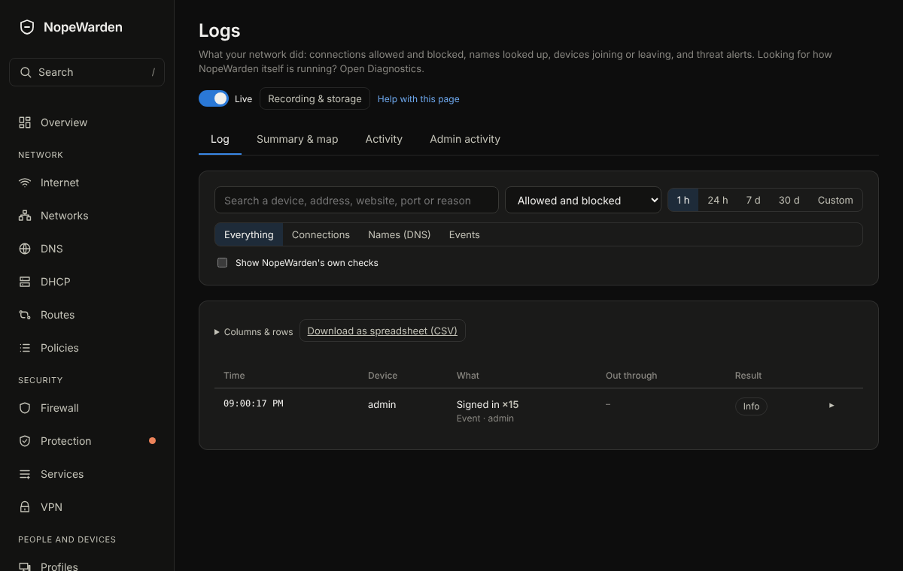

# Logs

## What it is for
What happened on your network and why: connections the firewall allowed or blocked, names your devices looked up, and changes.

The picture is an example from a new, empty box; yours will show your own devices and numbers.

## What is on the page
- Tabs: **Log**, **Summary & map** and **Activity**.
- The search box and filters: **Allowed and blocked**, a time range (1 h, 24 h, 7 d, 30 d, or custom) and **Everything**, **Connections**, **Names (DNS)** or **Events**. Live updates can be turned off.
- Every row is at most two lines: the app or website on top, the port and service below. **Out through** shows which connection or VPN it left by. Identical neighbouring entries become one row with a count.
- Click a row (or press Enter) for the rest: why, the rule, the host and address, the country, the networks, the times, and **Block this** or **Allow this**.
- **Columns & rows** chooses columns and how many rows load at a time. **Download as spreadsheet (CSV)** exports what you see.
- **Recording & storage** chooses what is recorded and how long it is kept.

## Common tasks
1. Find out why something was blocked: search for the device or site, click the row, read **Why**.
2. Block a destination: click its row, then **Block this**.
3. See which devices use a VPN: look at **Out through**.

Each row shows the internet connection or VPN it left through. For a DNS lookup that is the connection Gatehouse itself used to ask the DNS server; a lookup answered from memory shows none.

4. Gatehouse's own health checks are hidden. To see them, turn on **Show Gatehouse's own checks**.

## Example
Search for a game console, set the range to 1 h, and click a blocked row. **Allow this** makes a rule for exactly that traffic.

## If something goes wrong
If nothing is recorded, check **Recording & storage**; allowed and blocked connections can be switched off separately. Only the first packet of each connection is recorded, and a flood is capped.
