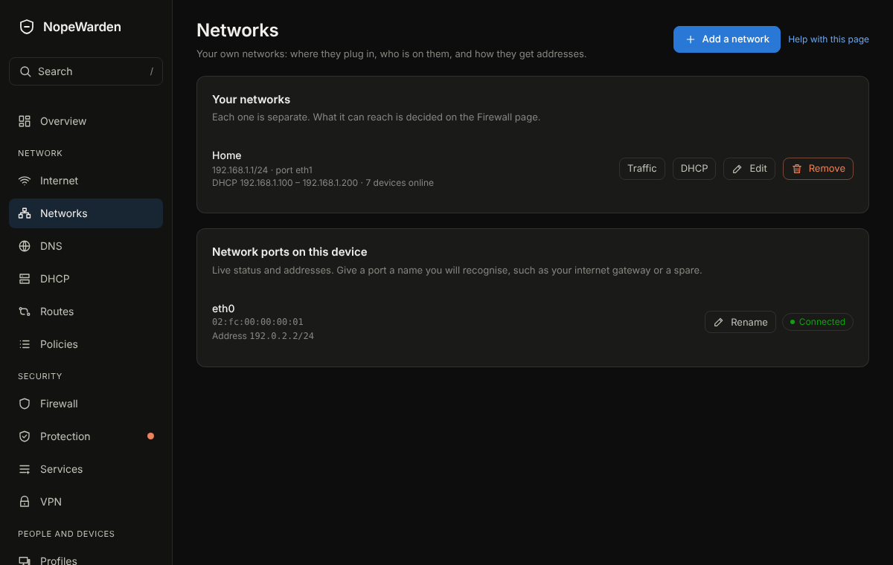

# Networks

## What it is for
Your own networks, such as Home, Guests or Cameras. Each one is separate; what it can reach is decided on the Firewall page.

The picture is an example from a new, empty box; yours will show your own devices and numbers.

## What is on the page
- **Your networks**: one row per network with its address, its ports and whether it hands out addresses (DHCP). **Add a network** makes another.
- **Edit** a network to change its **Address of this router on the network**, the **Port** it is plugged into, a **VLAN number** if it shares a port, and **What it can reach**. **In use** switches it off without deleting it.
- **Ports on this network** and **Add more ports to this network**: tick the ports that act as a switch for this network. Devices on any ticked port share its addresses.
- **Network ports on this device**: live status and addresses of every port. **Rename** gives a port a name you will recognise, such as your internet gateway or a spare.

## Wi-Fi and wireless

Wireless is not included in Gatehouse. The installer has no Wi-Fi drivers or firmware, the console has no Wi-Fi page, and a Wi-Fi card in the machine is ignored and cannot be used as an internet connection or a network. For Wi-Fi, plug a separate access point or Wi-Fi router into a port or VLAN on Networks, choose the type that fits (Guest for visitors), and set up the Wi-Fi name and password on that device. Gatehouse still filters, names and protects every device that connects through it, because they arrive over a wired port.

## Common tasks
1. Add a network: **Add a network**, choose what it is for (**Trusted**, **Private**, **Guest**, **Isolated** or **Custom**), choose **The whole port** or **A VLAN on the port**, **Save**, **Review and apply**. A Guest network keeps its devices from seeing each other; turn on **Devices here can talk to each other** only if they need to.
2. Connect a switch or access point that hands out addresses itself (this is also how Wi-Fi is added; see Wi-Fi and wireless below): choose **A VLAN on the port** and turn on **No address, no DHCP**. Gatehouse makes the VLAN and the firewall network and gives out nothing.
3. Name a port: **Rename**, type a name, **Save**. **Use the original name** puts it back.
4. Give a network more ports: **Edit**, **Add more ports to this network**, tick them, **Save**.

## Example
Make a Cameras network on its own port with the address 192.168.30.1/24, and on the Firewall page let it reach nothing but itself.

## If something goes wrong
Gatehouse refuses a port that already belongs to another network or the internet, and says which. Nothing changes until you apply, and the 60-second way back covers it.
