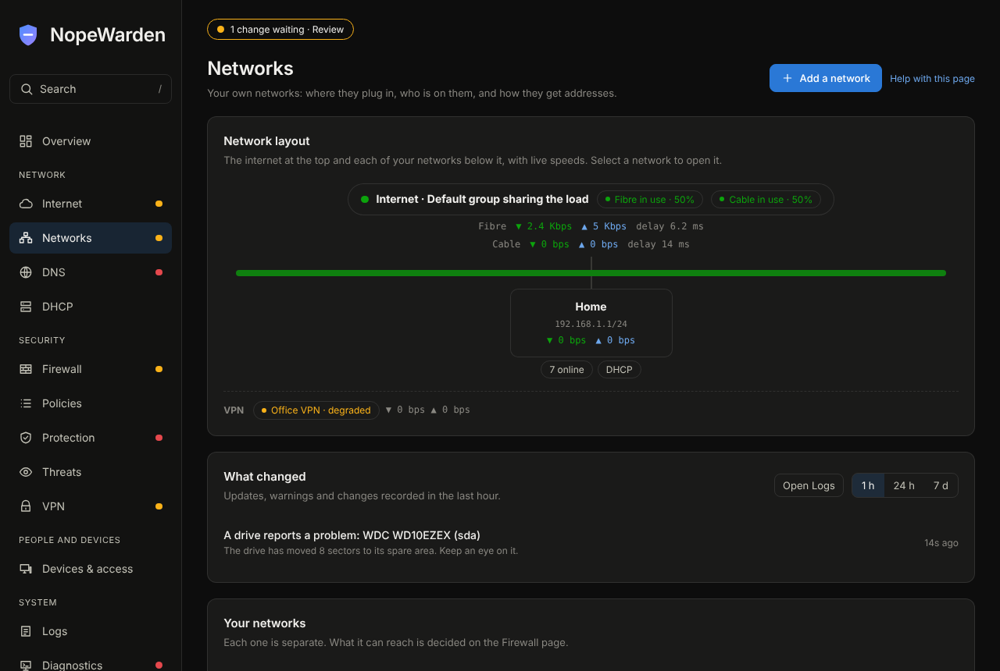
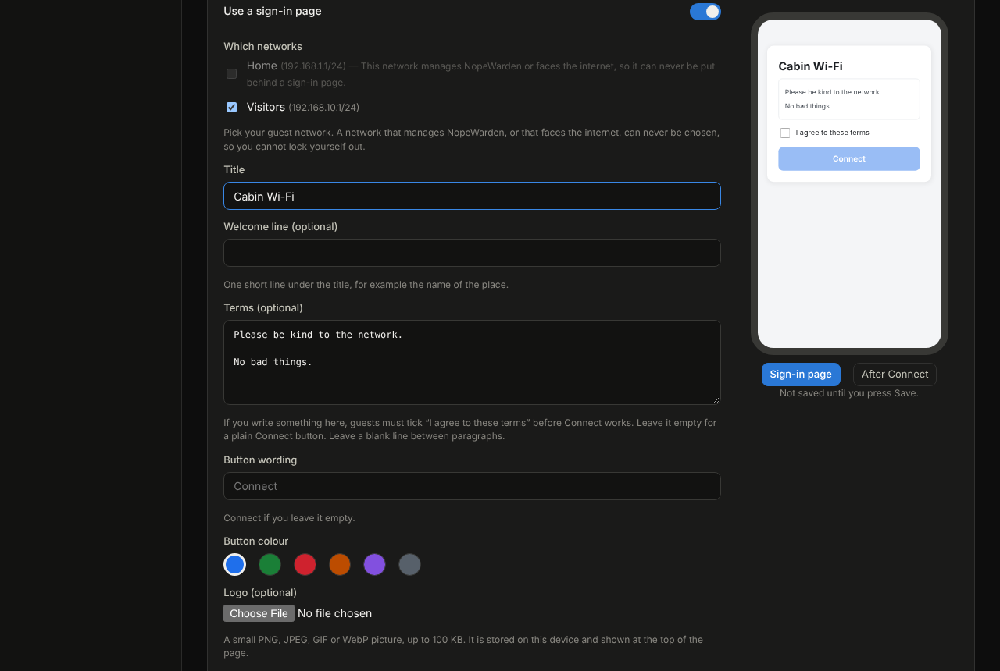

# Networks

## What it is for
Your own networks, such as Home, Guests or Cameras. Each one is separate. What each can reach is decided on the Firewall page.

The picture uses made-up devices and numbers. Yours will show your own.

## What is on the page
- **Network layout** is a map of the box. The internet connection is at the top and each of your networks sits below it, with live speeds, devices online and tags.
  - When two or more internet connections share the load, every working one shows as in use, with its share and its own live speed. Until you apply the change it says "Sharing is saved, not applied yet". "Standing by" is only for a connection that waits for another to fail.
  - Select a network to open it. Select a tag to open the page that explains it: devices online opens Devices & access, DHCP opens DHCP, Guest opens Firewall, Pool full opens the DHCP address pools.
  - If you have set a management port, a dashed box under the networks shows it. It has the port's name, "Answers on" and its address, and its live speed, laid out like your other networks. If the port stops answering the line says so with an amber dot, and a small button appears if the console is closed on the other networks. Nothing is routed through it. Select it to open Settings, Managing this device.
  - **What changed** has its own 1 h, 24 h and 7 d choice. It lists recent updates and warnings, or a line saying nothing changed.
- **Your networks** has one row per network with its address, its ports and whether it hands out addresses (DHCP). **Add a network** makes another.
- **Edit** a network to change its **Address of this router on the network**, the **Port** it is plugged into, a **VLAN number** if it shares a port, and **What it can reach**. **In use** switches it off without deleting it.
- **Ports on this network** and **Add more ports to this network**: tick the ports that act as a switch for this network. Devices on any ticked port share its addresses.
- **Network ports on this device** shows the live status and addresses of every port. **Rename** gives a port a name you will recognise, such as your internet gateway or a spare. If the port carries an internet connection, that connection takes the same name, and renaming the connection renames the port.

## Wi-Fi and wireless
Wireless is not part of NopeWarden. The installer has no Wi-Fi drivers or firmware, the console has no Wi-Fi page, and a Wi-Fi card in the machine is ignored. It cannot be used as an internet connection or as a network.

For Wi-Fi, plug a separate access point or Wi-Fi router into a port or VLAN on Networks, choose the type that fits (Guest for visitors), and set up the Wi-Fi name and password on that device. NopeWarden still filters, names and protects every device that connects through it, because they all arrive over a wired port.

## Common tasks
1. Add a network: **Add a network**, choose what it is for (**Trusted**, **Private**, **Guest**, **Isolated** or **Custom**), choose **The whole port** or **A VLAN on the port**, **Save**, **Review and apply**. A Guest network keeps its devices from seeing each other. Turn on **Devices here can talk to each other** only if they need to.
2. Connect a switch or access point that hands out addresses itself (this is also how Wi-Fi is added, see above): choose **A VLAN on the port** and turn on **No address, no DHCP**. NopeWarden makes the VLAN and the firewall network and gives out nothing.
3. Name a port: **Rename**, type a name, **Save**. **Use the original name** puts it back.
4. Give a network more ports: **Edit**, **Add more ports to this network**, tick them, **Save**.

## Example
Make a Cameras network on its own port with the address 192.168.30.1/24, and on the Firewall page let it reach nothing but itself.

## If something goes wrong
NopeWarden refuses a port that already belongs to another network or the internet, and says which. Nothing changes until you apply, and the 60-second way back covers it.

## Guest sign-in page

Under your networks is the **Guest sign-in page** card. It is off until you switch on **Use a sign-in page** and choose your guest network. A guest device then sees your page first and reaches the internet only after it taps the button. A network that manages NopeWarden or faces the internet can never be chosen, so you cannot lock yourself out.

Make the page your own with **Title**, **Welcome line**, **Button wording**, **Button colour** and a small **Logo**. The phone beside the settings shows the real page as you type; **Sign-in page** and **After Connect** switch between the two pages. Nothing is saved until you press **Save**.

If you write **Terms**, the page shows them with a box, **I agree to these terms**, and the button stays grey until it is ticked. With no terms the page is a single button.

**Stay signed in for** is a list: 1, 2, 4, 8, 12 or 24 hours, or 7 days (4 hours to start). The guest is told how long it lasts, for example “You are connected for 4 hours”. Signing in is separate from the address lease: when a guest's address runs out and they get a new one, they are not asked again, because the sign-in is remembered by the device's hardware address. A phone that uses a private Wi-Fi address may count as a new device and sign in again, and a device whose hardware address cannot be read is remembered by its address instead.

Guest networks you add start with a **2 hour** address lease, so addresses come back by themselves. A guest whose lease ended simply gets an address again; whether they sign in again depends only on the time above.

The page is plain http on port 8099 and works for IPv4. Guests who open a secure (https) site first may not be sent to it, though phones and laptops usually notice it by themselves. Do not use the page to collect secrets.

Guests cannot reach each other through NopeWarden, but two guests on the same Wi-Fi or switch talk directly and the firewall never sees it. Turn on **client isolation** (also called AP isolation or guest mode) on your access point. A network built from several of this device's own ports keeps its ports apart by itself when it is a Guest network.
