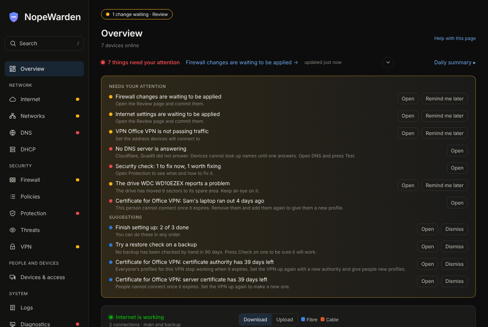
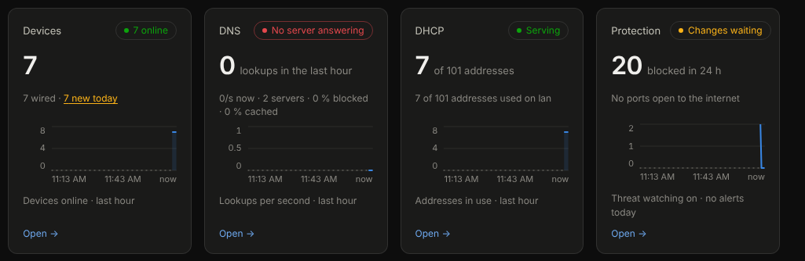
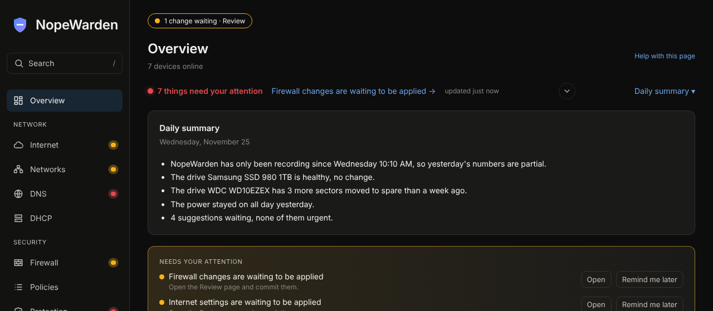

# Overview

## What it is for
One screen that tells you whether everything is fine and, if not, what needs you. Open it first when something feels wrong.

The picture uses made-up devices and numbers. Yours will show your own.

## What is on the page
- **Search** in the left menu (or press / or Ctrl+K) finds any page, setting, device, network or help topic and opens it with the right card lit up. If you cannot remember where something lives, search for what it does, or for its old name. "Blocking lists" and "how often to check" still find their new homes.
- The status line sits under the title. It has a coloured dot, how many things need you ("1 thing needs your attention"), a link to the first one, and when the page last updated. The dot is green when nothing needs you and amber or red when something does. At the right end, **Daily summary** opens yesterday's recap (see below). The round arrow hides or shows the box underneath, and NopeWarden remembers your choice.
- The attention box has two lists. **Needs your attention** holds amber and red items. **Suggestions** holds blue ones, such as making a first backup or turning on two-factor sign-in. Every row has an **Open** button that takes you to the right place.
  - A suggestion can be **Dismissed**. It stays hidden until what it says changes, and the link under the list ("Show 1 dismissed suggestion") brings it back.
  - An amber row has **Remind me later**, which hides it for a day or a week. It comes back by itself, and **Remind me now** brings it back sooner.
  - A red row means it needs you now. It can never be dismissed or snoozed. The word "Broken" is kept for things that have really stopped, such as a failed service or a link that is down.
  - Advice from the Security check, such as turning on two-factor sign-in, is dismissed on the Protection page, not here.
  - Whatever you hide here still shows as a small dot beside the page in the left menu. Your choices belong to your account, so they follow you to any browser.
- The coloured dots in the left menu mark the page that needs you, and the tab inside that page that holds the reason. Hover a dot to read why. It goes away when the thing is dealt with.
- The internet card shows speed right now and a chart over 5 minutes, 15 minutes, an hour, 24 hours, 7 days or 30 days. Choose Download, Upload or Both above the chart (Both is the default); Both draws a green download line and a blue upload line, each the total of all your connections.
- **Devices, DNS, DHCP and Protection** are four small cards with the numbers that matter now: devices online, lookups in the last hour, addresses in use, connections blocked in a day. Each has a small chart of the last hour. The scale is on the left (top, middle and zero) and the times run along the bottom, ending in "now". The cards line up, so the charts sit at the same height. On Devices, the line under the number also tells you when devices are new today or have no name, and each of those is a link to the Devices page. On DHCP it says how many addresses are used on your network, or which network is the busiest. **Open** takes you to the full page.

  

- **Where connections go** is a small world map of where your connections went, by country. The full map is on Logs, Summary. Choose **Outgoing**, **Incoming** or **Both**, and a time period. With **Both**, green lines are what your devices connect to and amber lines are attempts from the internet. Hover a country to see its numbers. The lines start from your place on the map. Until you set that, they start from the middle of your country.
- **What happened** lists the latest events in plain words, newest first, with repeats folded into one row and a count.
- **Your networks** shows each network and how busy it is.
- **Busiest devices** and **Data used, last 24 hours**.
- **This machine** shows processor, memory and disk. **What's using it?** opens Diagnostics, which lists the biggest places on the disk.
- **Hide or show cards** at the bottom of the page lets you untick any card you do not want. Each person has their own choice.

Cards update on their own. If updates stop, a "Reconnecting" label appears at the top right.

## The daily summary

The picture uses made-up devices and numbers. Yours will show your own.

Press **Daily summary** at the right end of the status line. It opens a short recap in plain sentences, with no AI behind it, just fixed rules. It says whether anything needs you, lists up to three things to open, and then covers yesterday: internet drops, the most devices online, how many lookups were made and how many were blocked, attempts from the internet that were blocked, threat alerts, how each drive is doing, and whether the power stayed on. If the box has only been recording for part of the day, it says so. If you would rather not see the toggle, hide it under **Hide or show cards**.

## Common tasks
1. To see why the internet is down, look at the first card. It says in words what is wrong and links to **Internet**.
2. To find the busiest device, read **Busiest devices** and click it.
3. To follow a suggestion, press **Open** beside it.
4. To make the map's lines start from your home, open Settings, General, **Your place on the map** and press **Change**. The page walks you through it.

## Example
The **What happened** card shows a device contacting a known-bad address nine times. Click the row to open Protection, or **Open logs** to see exactly which destinations they were.

## If something goes wrong
If a card is empty, it has nothing to show yet, or the machine has no sensor for it. If every card says it cannot refresh, check that you can still reach the machine, then press **Try again now**.
