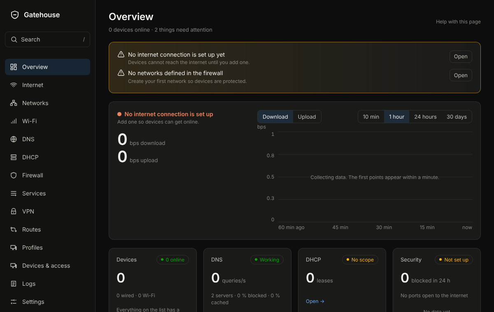

# Overview

## What it is for
One screen that tells you whether everything is fine, and what needs you. Open it first when something feels wrong.

The picture is an example from a new, empty box; yours will show your own devices and numbers.

## What is on the page
- **Finish setting up** (only while something is left): a short checklist with a button beside each item.
- **Suggestions**: things worth doing, such as a first backup or turning on two-factor sign-in. Each links to the right page.
- **Devices**, **DNS**, **DHCP** and **Security**: one card each with the numbers that matter now, such as how many devices are online and how many connections were blocked in the last hour.
- **Your networks**: each network and how busy it is.
- **Where connections go**: a world map of where your connections went, by country.
- **Busiest devices** and **Data used, last 24 hours**.
- **This machine**: processor, memory and disk.

Cards update on their own. If updates stop, a "Reconnecting" label appears at the top right.

## Common tasks
1. To see why the internet is down, look at the first card. It says in words what is wrong and links to **Internet**.
2. To find the busiest device, read **Busiest devices** and click it.
3. To follow a suggestion, press its button.

## Example
The **Security** card shows many blocked connections. Click **Open logs** to see exactly which devices and destinations they were.

## If something goes wrong
If a card is empty, it has nothing to show yet, or the machine has no sensor for it. If every card says it cannot refresh, check that you can still reach the machine, then press **Try again now**.
