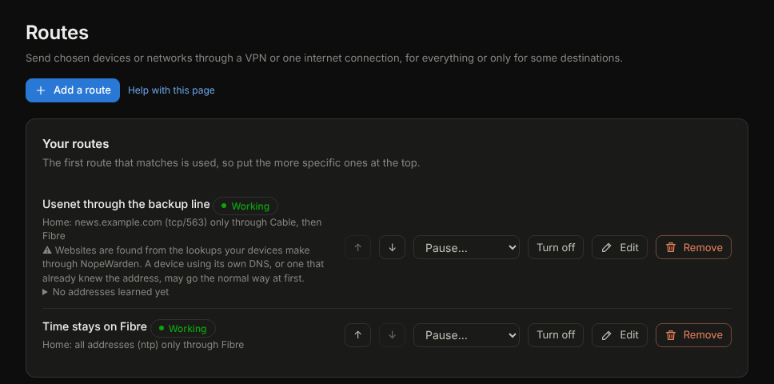

# Policies

## What it is for
One list of everything you have set up to allow, block, route or open something for your devices, written in plain words. Firewall rules, routes, blocks and open ports are four kinds of the same thing: who it covers, where to, what for, and when.

## What is on the page
The page has two tabs: **All policies**, the list below, and **Routes**, where traffic is sent through a VPN or a chosen connection. Routes used to be a page of their own in the menu; old links still land on the Routes tab.

- **Create policy** asks what you want to do (allow or block traffic, send traffic through a VPN or connection, open a port, or block an app, category or website) and opens the right form.
- **Your policies** shows every policy with its kind, whether it is working, and one sentence saying what it does. A warning shows on the row when something needs a look.
- **All kinds** narrows the list to one kind.
- Each row has **Pause…**, **Turn off** (or **Turn on**), **Edit** and **Remove**. **Edit** opens the form on the page that owns that kind of policy. **Remove** can be undone for a few seconds, except blocks and open ports, which ask first.
- The order of rules and routes, the network matrix and the finer settings stay on the **Firewall** and **Protection** pages and the **Routes** tab. This page reads the same policies as they do, so a change made on either shows on both.

## Common tasks
1. Keep a device offline at night: **Create policy**, **Allow or block traffic**.
2. See everything that affects one kind of traffic: scan the list, or use **All kinds**.
3. Turn something off for a while without deleting it: **Pause…**.

## If something goes wrong
A policy marked **Needs a look** or showing a warning explains itself on its row. Policies made by the countries page and the network matrix are not listed here; they live on the Firewall page.

## The Routes tab
Send some traffic through a VPN by rule: everything from certain devices, or only some destinations.

The picture is an example; yours will show your own routes and connections.

- **Your routes**: the first route that matches is used, so put the more specific ones at the top with **Move up** and **Move down**. Each row has **Pause…**, **Turn off**, **Edit** and **Remove**; every route also says in words what it does and whether it is working, paused or on a schedule. Every change is written to Admin activity.
- **Add a route** takes a **Name**, **Send the traffic through** (a VPN, internet connections, or a connection group). Choosing **internet connections** lets you tick one or several in the order you want: the first one that is working is used, or choose to share across them. A connection kept only as a backup can be chosen on its own, **Kill switch** for a VPN, then **Who**, **Where to**, **What for** and **When**. These are the same pickers the firewall rules use, so a device, a network, a group, an address, a website or a country is chosen the same way everywhere.
- **Who** takes any mix of networks, devices, device groups and addresses. **Where to** takes any mix of websites, addresses, ranges and countries. **What for** takes services such as NTP or NNTPS, your own saved port lists, or ports like tcp/563. Leave a box empty to mean everyone, anywhere, or any traffic. Several entries in each box are combined: every one of them applies.
- **When** limits the route to certain hours or days of the week. Outside them the traffic takes the normal way.
- **Turned on** keeps a route without using it.
- VPNs that send whole devices through them are set up on the VPN page and shown below your routes.

### Common route tasks
1. Send one website through a VPN: **Add a route**, type it under **Where to**, choose the VPN, **Save**.
2. Send a country's traffic: choose a country under **Where to**.
3. Send one kind of traffic: choose it under **What for**, for example NTP, or tcp/563 for Usenet over TLS.
4. Pause a route for a while: **Pause…** and choose how long, or until you resume it. **Resume now** brings it back. Connections already open keep the way they started; new ones follow the pause.
5. **Remove** deletes a route and can be undone for a few seconds.

### Example route
A streaming app only works from another country: add a route for its website through a VPN in that country, for your TV only.

### If a route does not work
**Not working** means the VPN behind the route is down. **Needs two connections** means a route needs more than one internet connection. **Needs attention** means the service list the route uses no longer exists, so the route sends nothing until you choose another service. With **Kill switch** on, the traffic stops rather than leaking.

### Addresses learned for a website
Each website route shows the addresses NopeWarden has learned for the site and when. They are filled in as devices look the site up, and cleared when you delete the route. If you edit a route, saving works with the route exactly as the list shows it.
