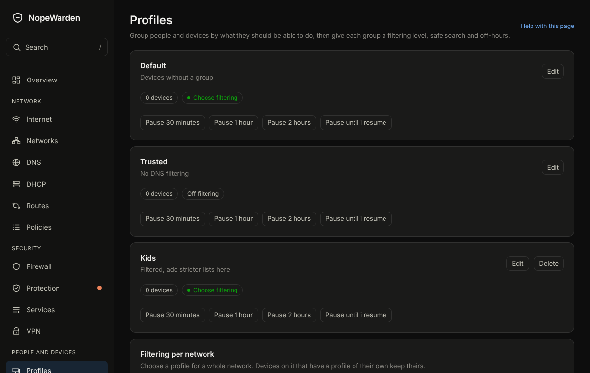

# Profiles

## What it is for
A profile decides which blocklists apply to a device and when the internet is off for it, such as a Kids profile.

The picture is an example from a new, empty box; yours will show your own devices and numbers.

## What is on the page
- **Profiles**: each with a **Name**, **How much to filter**, **Safe search**, and **Internet off at set hours** (**Off from** and **Back on at**). **Pause** buttons stop the internet for that profile's devices for a while, and **Resume internet** undoes it.
- **Add a profile**: start from **Blank profile**, **Basic** or **Enhanced**, then change anything.
- **Filtering per network**: choose a profile for a whole network. Devices that have a profile of their own keep theirs.

## Common tasks
1. Pause a profile: press the pause length you want on the profile.
2. Make a Kids profile: **Add profile**, choose a preset, name it, set the hours, **Save**.
3. Put a device in a profile: on **Devices & access**, open the device and choose its **Profile**.

## Example
Kids: **Enhanced** filtering, **Safe search** on, internet off from 21:00 to 07:00.

## If something goes wrong
Deleting a profile moves its devices back to the Default profile. Safe search works for browsers that use NopeWarden for DNS; turn on forced DNS for devices that do not.
