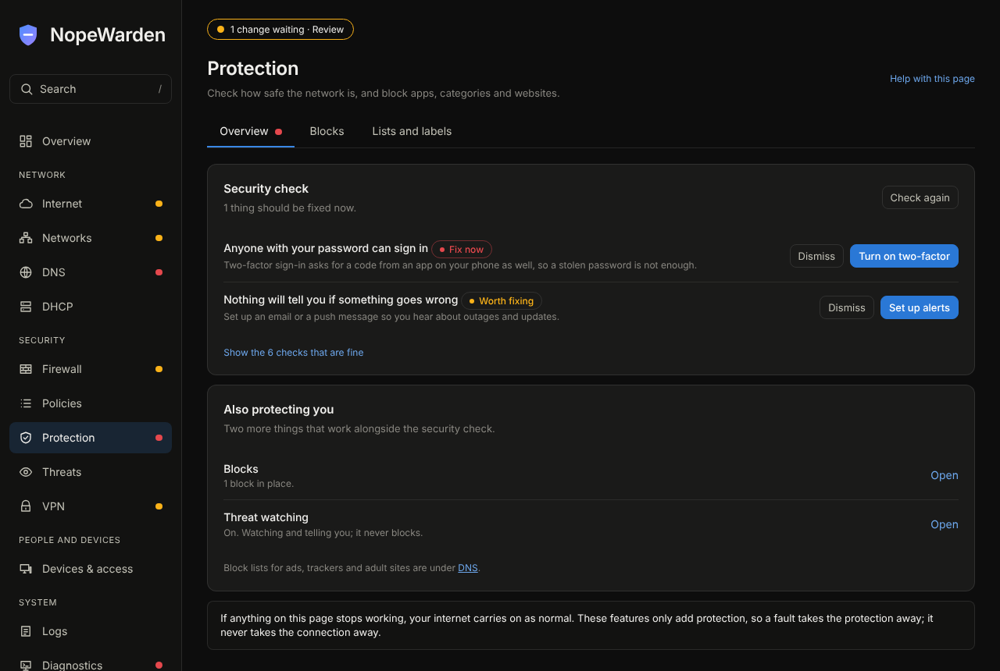

# Protection

## What it is for
One place for keeping the network safe: a check of what to fix, and blocking apps, categories and websites. Watching for threats has its own page, Threats. Block lists for ads, trackers and adult sites live under DNS.

The picture uses made-up devices and numbers. Yours will show your own.

## What is on the page
Tabs along the top:

- **Overview** starts with the **Security check**, which lists what to fix and gives you a button that goes to the right page. Below it, **Also protecting you** has a line each for your blocks and for threat watching.
- **Blocks** starts with **Where do I block things?**, which tells you which page blocks what: apps, categories and websites here; ads, trackers and malware under DNS; which devices get which lists under Devices & access, Profiles; countries and ports in the Firewall. The **Blocks** card lists one row per block with its name, what it holds, where it applies, when, how, and how many lookups it refused in the last day. **Add a block** takes an optional name and lets you choose many apps, categories and websites in one block. You then say where it applies (everyone, or any mix of networks, profiles and devices), how, and when (always or at set hours). **Start from** fills the form with Social media, Streaming, Gaming or AI chat, ready to change. **Pause…** stops a block for a set time or until you resume it. Blocks have the same controls as firewall rules and routes: pause, turn off, edit, remove.
- **Lists and labels** has **App and category lists**, which shows which version of the app names and category lists blocking uses and how fresh each download is. A list that could not be downloaded says so, and the last good copy keeps working. A list nothing uses yet says **Not in use yet** and is downloaded the first time a block needs it. Under the lists, a line says when they update by themselves (daily at 04:10 unless you change it) and when they next will, with **Change when** and **Run now**. **Traffic labels** names the app behind each connection by looking at the first packets. It is off by default.
- **Exceptions** is a separate card. **Add an exception** lets things through for a device, profile or network even when a block says no.

Threat watching has its own page, **Threats**, in the left menu under Security.

The ad, tracker and malware lists on the DNS page are a different thing from the app and category lists here. The app and category lists power the blocks on this page.

## The Security check
Each fix button opens the exact window that changes the setting. Some items are advice, such as turning on two-factor sign-in or setting up alerts. Advice also has **Dismiss**, for someone who has decided to live without it.

A dismissed item stops counting. It leaves the Overview list, the Daily summary and the menu dot. It stays on this page behind the link under the list (for example "Show 1 dismissed item"), marked Dismissed, with **Bring it back**. It returns by itself only if its wording changes. A real fault, such as a guest network that can reach the console, can never be dismissed.

## Typing websites
A website covers everything under it, so youtube.com also covers music.youtube.com. A leading *. is accepted and changes nothing: *.youtube.com means the same.

## Names inside a category, and your own names per profile
- **View names** next to a category shows the names it blocks. You can search it, and allow a name that should not be blocked.
- Each profile can have its own **custom blocked names**.

## Removing things a block uses
When you remove a network, a profile or a device, it also leaves the blocks that used it. The question before the removal names those blocks first. A block left with no place shows **Applies nowhere** until you choose one.

## Deleting a block
Delete removes the block at once and shows an Undo button for a few seconds. Nothing asks "Are you sure?".

## Common tasks
1. See what needs fixing: **Overview**, read the **Security check**, press the button beside a risk.
2. Block several apps for a child's devices: **Blocks**, **Add a block**, give it a name, choose the apps, choose the devices, choose the hours, **Save**.
3. Let one device keep an app: **Exceptions**, **Add an exception**, choose the app and the device, **Save**.

## What happens if something goes wrong
These features only add protection. If they fail, the protection goes and your internet carries on, so your traffic is never held up. A block that cannot be worked out lets the lookup through, and the Logs say so once an hour.

## If something goes wrong
If a block does not seem to work, check that it is switched on and that the device uses NopeWarden for DNS. Blocking by name cannot catch an app that uses its own private DNS, so choose both ways to cover more. Problems with threat watching are on the Threats page.
