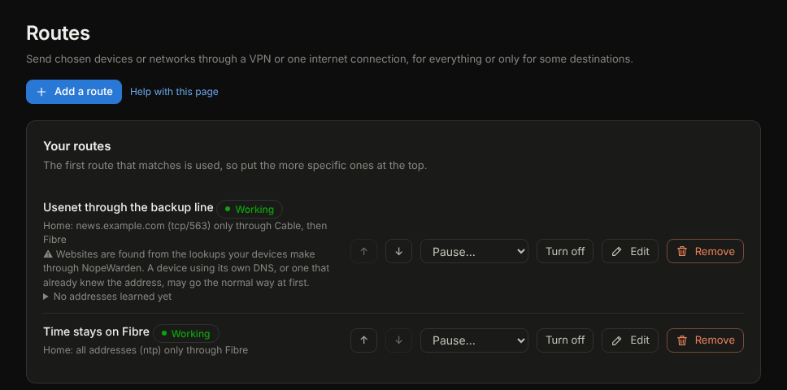

# Routes

## What it is for
Send some traffic through a VPN by rule: everything from certain devices, or only some destinations.

The picture is an example; yours will show your own routes and connections.

## What is on the page
- **Policies** (next to Routes in the menu) lists routes together with firewall rules, blocks and open ports, and its **Create policy** button asks what kind you want and opens the right form. They all use the same pickers, the same words and the same controls.
- **Your routes**: the first route that matches is used, so put the more specific ones at the top with **Move up** and **Move down**. Each row has **Pause…**, **Turn off**, **Edit** and **Remove**; every route also says in words what it does and whether it is working, paused or on a schedule. Every change is written to Admin activity.
- **Add a route** takes a **Name**, **Send the traffic through** (a VPN, internet connections, or a connection group). Choosing **internet connections** lets you tick one or several in the order you want: the first one that is working is used, or choose to share across them. A connection kept only as a backup can be chosen on its own, **Kill switch** for a VPN, then **Who**, **Where to**, **What for** and **When**. These are the same pickers the firewall rules use, so a device, a network, a group, an address, a website or a country is chosen the same way everywhere.
- **Who** takes any mix of networks, devices, device groups and addresses. **Where to** takes any mix of websites, addresses, ranges and countries. **What for** takes services such as NTP or NNTPS, your own saved port lists, or ports like tcp/563. Leave a box empty to mean everyone, anywhere, or any traffic. Several entries in each box are combined: every one of them applies.
- **When** limits the route to certain hours or days of the week. Outside them the traffic takes the normal way.
- **Turned on** keeps a route without using it.
- VPNs that send whole devices through them are set up on the VPN page and shown below your routes.

## Common tasks
1. Send one website through a VPN: **Add a route**, type it under **Where to**, choose the VPN, **Save**.
2. Send a country's traffic: choose a country under **Where to**.
3. Send one kind of traffic: choose it under **What for**, for example NTP, or tcp/563 for Usenet over TLS.
4. Pause a route for a while: **Pause…** and choose how long, or until you resume it. **Resume now** brings it back. Connections already open keep the way they started; new ones follow the pause.
5. **Remove** deletes a route and can be undone for a few seconds.

## Example
A streaming app only works from another country: add a route for its website through a VPN in that country, for your TV only.

## If something goes wrong
**Not working** means the VPN behind the route is down. **Needs two connections** means a route needs more than one internet connection. With **Kill switch** on, the traffic stops rather than leaking.

## Addresses learned for a website
Each website route shows the addresses NopeWarden has learned for the site and when. They are filled in as devices look the site up, and cleared when you delete the route. If you edit a route, saving works with the route exactly as the list shows it.
