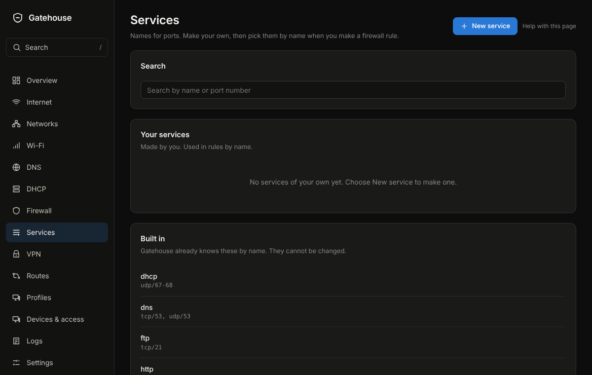

# Services

## What it is for
A service is a name for one or more ports, such as "plex" for tcp/32400. Rules pick services by name instead of by number.

The picture is an example from a new, empty box; yours will show your own devices and numbers.

## What is on the page
- **Search services**: type a name or a port.
- **Your services**: the ones you made, with **New service**, **Edit** and **Delete**. Deleting one can be undone for a few seconds, unless a rule uses it.
- **Built in**: names NopeWarden already knows. They cannot be changed.

## Common tasks
1. Make a service: **New service**, give it a **Name**. Under **Ports** choose **Protocol** (TCP, UDP, **TCP and UDP**, or ICMP for ping), type a port or a range such as 27000-27050, and press **Add**. Each port appears in the list below, and ✕ removes one. A wrong entry is explained in words under the box. For a known name such as https use **add a known name**; for a long list use **paste a list**, one entry per line like tcp/32400. Then **Save**.
2. Use it: in any rule or open port, type its name in the "What for" box. Several can go in one box, separated by commas or spaces.
3. Find a built-in one: type its name in **Search services**.

4. Rename a service you made: **Edit**, change the **Name**, **Save**. Rules and open ports that use it follow the new name. A service used by an open port cannot be deleted until the port is removed.

## Example
Make "console-game" with udp/3074 and tcp/3074, then use it in a rule for your console.

## If something goes wrong
A service that a rule, an open port or a route uses cannot be deleted until that changes; NopeWarden names it.
