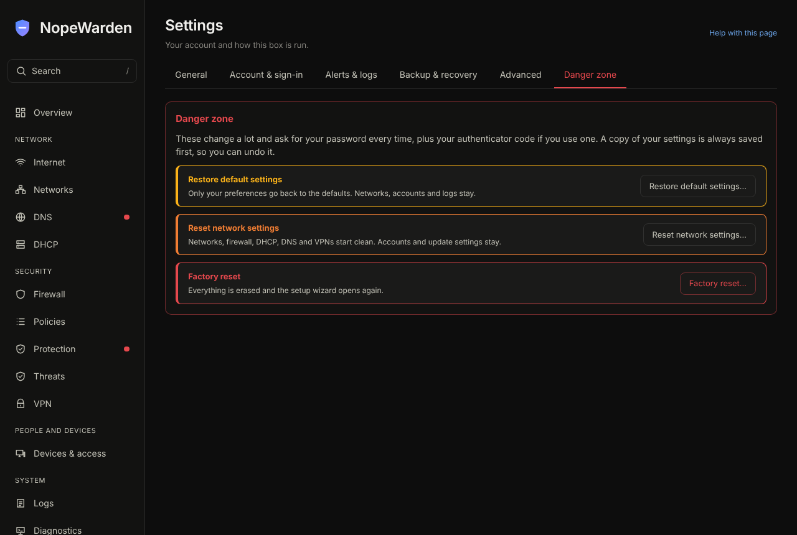

# Settings

## What it is for
Your account, and how this box is run. It is split into seven tabs.

The picture is an example from a new, empty box; yours will show your own devices and numbers.

## What is on the page
- **General**: **Finish setting up** (only while something is left) and **Common setups** (the guides are folded; **Show the guides** opens them), **Device mode** (Router or Bridge, with a three-step change), **Management port** (a spare port for managing this device), **Power** (restart or shut down), **Console address**, **Your place on the map** (a single line saying where you are set to, with **Change**; **Find a place** by zip or postal code, city or address, or type your latitude and longitude, click the map or pick a country; only the words you search for are sent, to OpenStreetMap, and the saved place stays on this machine and is placed within about a degree) and **Appearance**.
- **Account & sign-in**: **Two-factor sign-in**, **Password**, **Where you are signed in** (the round arrow button at the bottom of the left menu signs you out of this browser at once) and **Remote login** (SSH, off unless you turn it on; if the machine has no SSH identity yet, NopeWarden makes one when you turn it on).
- **Alerts & logs**: **Alerts** (ntfy or email, with **More: quiet hours** folded under it), **Send logs elsewhere**, **Send traffic records (NetFlow / IPFIX)**, SNMP and **Storage** (what is kept on this machine's disk, about how much room each kind takes, and when it is removed).
- **Backup & recovery**: **Backups** (the newest 10 are listed, with **Previous**, page numbers and **Next** under the list, a count such as "Showing 1 to 10 of 27 backups", and **Rows per page** (10, 25 or 50, remembered); with a folded **Backup history** of every backup, restore, upload, download and delete, failed ones too, and who did it; and **Include history (logs)**, off by default, which adds the logs to backups), **Changes** (a copy before every change, to go back to).
- **Danger zone**: its own red tab for administrators, holding the three resets described below.
- **Advanced**: **High availability** (two boxes as a pair), **Bridge mode** (all the detailed settings) and **Guest sign-in page**. Updates have their own page, Updates; **Traffic labels** and **Lists used for blocking** are on Protection, under Lists and labels.

Administrators see all six tabs. Other accounts see only their own sign-in settings and Appearance. The page reopens on the tab you used last.

## The Advanced and alert cards in more detail
- **Send logs elsewhere**: copies NopeWarden's events to a syslog server you run, such as a NAS or a log tool. Enter its address and port, switch it on, and watch the card for the last send. It is off by default, and a server that is down never slows the firewall.
- **Send traffic records (NetFlow / IPFIX)**: tells a traffic-analysis tool which devices talked to which, and how much. Only the collector you name receives it. Off by default.
- **High availability**: two NopeWarden machines as a pair. One is active; if it fails, the other takes over within seconds and devices keep their addresses. Bridge mode and a pair cannot be used together yet.
- **Let a monitoring tool read this device (SNMP)**: read-only, shows the name, uptime and each port's traffic to a tool such as a graphing server. Off by default; set a community string before you switch it on.
- **Bridge mode**: use NopeWarden as a filter between another router and your network without routing or changing addresses. Switch it on from **Device mode** first; this card holds the detailed settings.

- **Storage**: a folded table (**Show what is stored**) of everything NopeWarden keeps (connections, DNS lookups, activity, device traffic, data by country, overview charts, speed tests, threat alerts, outages and firewall change copies) with its entries, estimated size, oldest entry and the rule that removes it. Set how long **traffic and events**, alerts and outages, and admin activity are kept, and how many firewall change copies to keep. Admin activity (who signed in and what they changed) is kept for 365 days unless you change **Keep admin activity for (days)**. A line under the table says what a clean-up would remove right now, and when the last one ran. **Clean up now** applies the rules straight away. Under **Clear by hand**, tick the kinds you want to empty (or **Select all**) and press **Clear selected…**; it names what will go and asks for your password, plus your authenticator code if you use one. Admin activity and the firewall change copies are not offered there, and the clear itself is written to admin activity. Sizes are estimates. **Keep chart history for** chooses how long the charts remember: 90 days, 1 year (the default), 2, 5 or 10 years, or Everything. One point a day is kept for every chart, with the day's lowest and highest, and the size limit never trims it. **Keep hourly chart detail for** chooses how long the hourly points last (31, 90 or 365 days), with the extra size shown.

## The Danger zone

Three cards of rising severity on the red **Danger zone** tab, for administrators only. **Restore default settings** puts only your preferences (backup schedule, alert choices, how long logs are kept, update checks and what the console shows) back to the defaults; networks, accounts and logs stay. **Reset network settings** starts networks, firewall, DHCP, DNS and VPNs clean; accounts and update settings stay. **Factory reset** erases everything and opens the setup wizard again; you type the word reset to confirm. All three ask for your password every time, plus your authenticator code if you use two-factor sign-in, and save a copy of your settings first so it can be undone. They are refused while an update is running.

## Common tasks
1. Change mode: **General**, **Device mode**, **Change**, then follow the three steps. Nothing is saved until the last step, and you have 60 seconds to keep it.
2. Turn on two-factor sign-in: **Account & sign-in**, **Turn on**, scan the code.
3. Make a backup: **Backup & recovery**, **Back up now**.

## Example
Turn on two-factor sign-in under **Account & sign-in**, then make a backup under **Backup & recovery**.

## If something goes wrong
A mode change that is not kept goes back on its own, and the card says so. See Getting back in for lock-outs.

## One schedule for every recurring job
Update checks (set on the Updates page), blocklist refreshes, country lists and threat rules all use the same schedule editor: **Every N hours**, **Daily at** a time, **Weekly on** a day and time, or **Off**. The sentence beside it says in plain English when the next run is. A job that fails retries after 5 minutes, 15, 30, and then every hour until it works.

## A port just for managing the device
**Management port** (on the **General** tab) sets one spare port aside for managing NopeWarden and nothing else. The console and remote login answer on it, and nothing is routed through it: no internet, no DHCP server, no sharing with your other networks.

1. Plug a cable from a management computer or switch into a spare port.
2. Choose the port, then choose **From DHCP** or **Fixed address**. With either, people on other subnets, such as a VPN, can reach the console: with DHCP the router the server names is used, and with a fixed address the **Gateway** you type is used. That router only answers them; it never becomes this device's route to the internet. A fixed address needs a range no network on this device already uses; NopeWarden refuses one that overlaps. If no DHCP server answers, the port has no address, so use a fixed address if you need to be sure of reaching it.
3. Press **Save and test**. Open the console on the new address within a minute. If nobody does, the change is undone on its own, or press **Undo now**.
4. The firewall rules for the port go live with the next firewall apply.

Once the port is proven you can turn on **Close the console on the LAN while this port is healthy**. You can only do this from the management address, so you cannot shut yourself out. The LAN console closes after the port has been healthy for half a minute, and opens again by itself if the port stops answering for a minute. Bridge mode has its own out-of-band port, so a management port is not used there.
