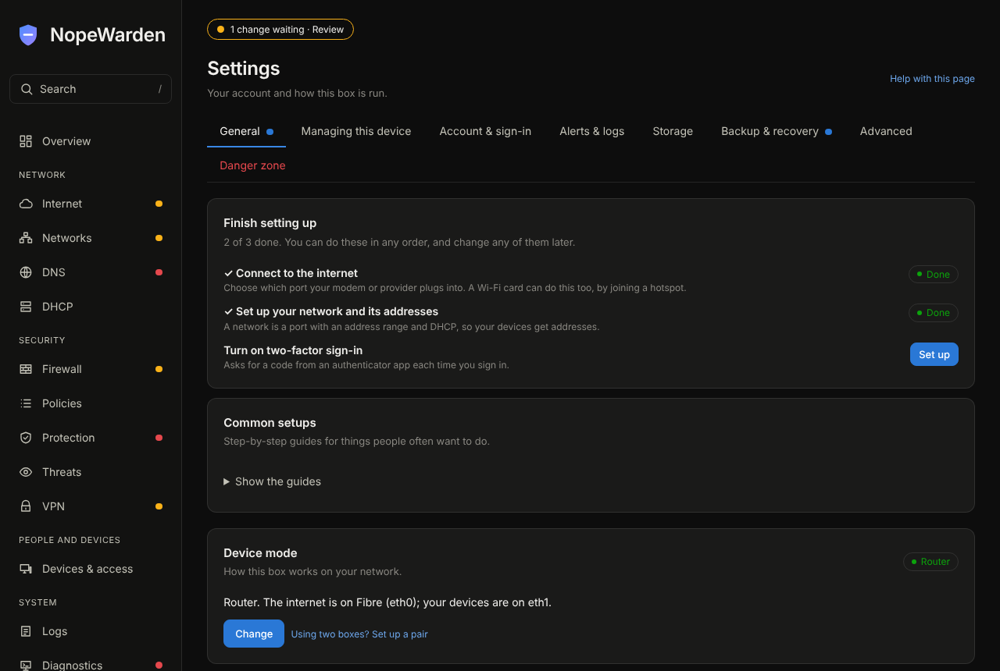
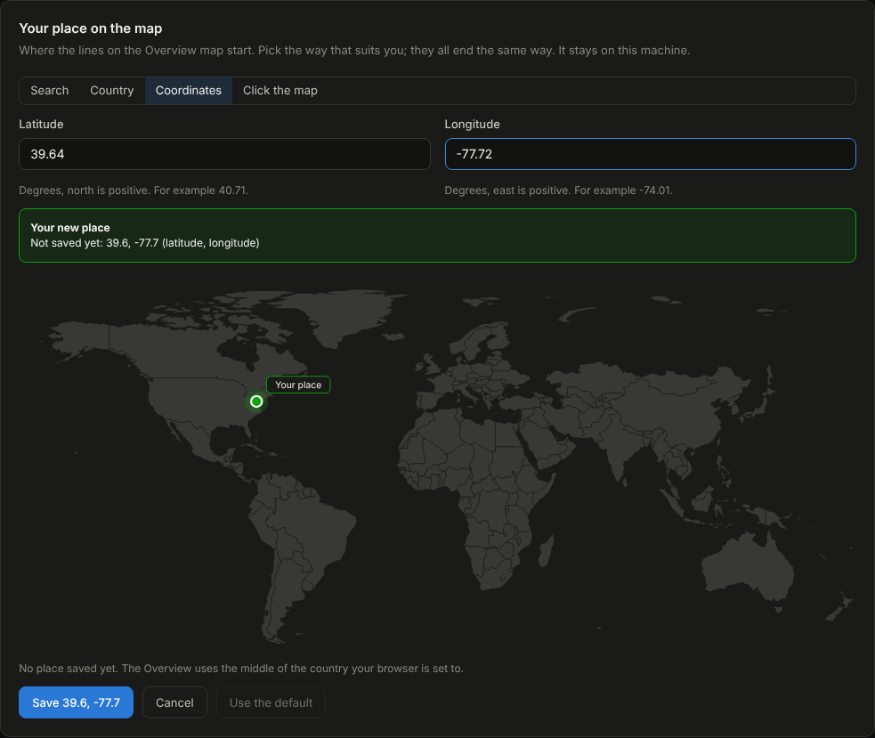
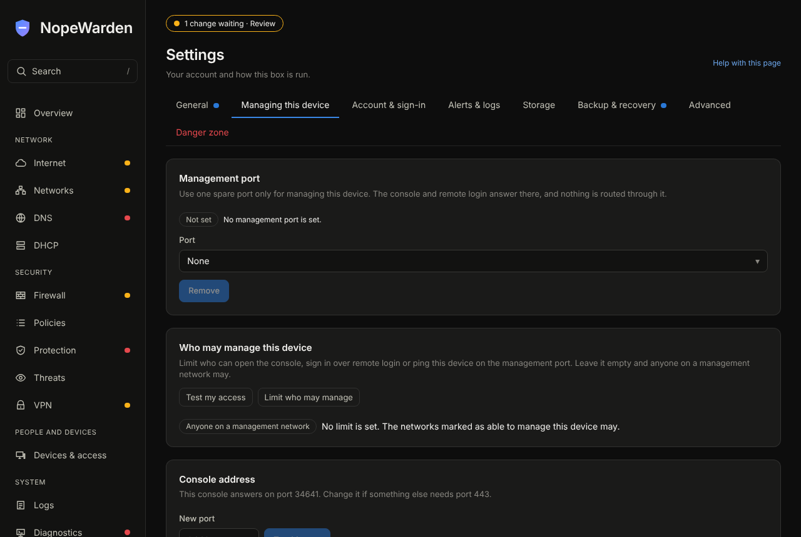
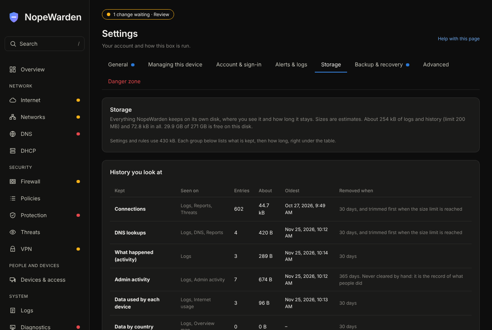
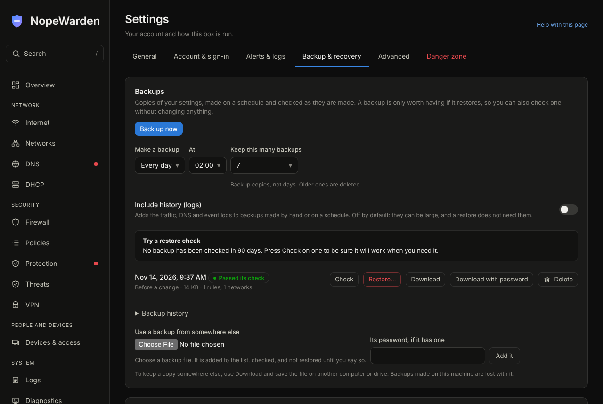

# Settings

## What it is for
Your account, and how this box is run. It is split into tabs, and the page reopens on the one you used last.

The picture uses made-up devices and numbers. Yours will show your own.

## What is on the page
Administrators see every tab. Other accounts see only their own sign-in settings and Appearance.

- **General** holds **Finish setting up** (only while something is left), **Common setups** (step-by-step guides, folded; **Show the guides** opens them), **Device mode** (Router or Bridge), **Power** (restart or shut down), **Your place on the map** and **Appearance**.
- **Managing this device** holds everything about how you reach this box: **Management port**, **Who may manage this device** (with **Test my access**), **Console address** and **Remote login**.
- **Account & sign-in** holds **Two-factor sign-in**, **Password**, **Password rules** and **Where you are signed in**. The round arrow at the bottom of the left menu signs you out of this browser straight away.
- **Alerts & logs** holds **Alerts** (a phone message through ntfy, or email, with **More: quiet hours** folded under it) and a folded **Send data to other tools**. That folded part has **Send logs elsewhere**, **Send traffic records (NetFlow / IPFIX)** and SNMP. These only send data out. They keep nothing here.
- **Storage** shows everything NopeWarden keeps on its own disk and for how long. See below.
- **Backup & recovery** holds **Backups** and **Changes**. See below.
- **Advanced** holds **High availability** and **Bridge mode**. The **Guest sign-in page** is on the Networks page, next to your guest network. Updates have their own page, and **Traffic labels** and the app and category lists are on Protection, under Lists and labels.
- **Danger zone** is a red tab for administrators with the three resets.

## Your place on the map
The Overview map draws its lines from your home. **Your place on the map** (General) shows where you are set to. Press **Change** to set it. There are four ways, shown as tabs, and all of them end in the same pin and the same Save button.

- **Search**: type a zip or postal code, a city or a street address and press **Find**. The matches appear right under the box and the map marks where each one is. Pick the right one. If there is only one match, it is picked for you. Only the words you type are sent, to OpenStreetMap's search, and only when you press Find. Your saved place is never sent anywhere.
- **Country**: pick a country from the list (United States is first). The pin goes to the middle of it.
- **Coordinates**: type your latitude and longitude.
- **Click the map**: click anywhere on it.

A green pin labelled "Your place" shows your new choice, with the words "Not saved yet" and the numbers beside it. The place you saved before stays on the map as a small grey ring so you never mix the two up. The **Save** button says exactly what it will save, for example "Save 39.6, -77.7". **Use the default** goes back to the middle of your country. The place is kept on this machine only, and it is accurate to about a degree.

## Managing this device

The picture uses made-up devices and numbers. Yours will show your own.

**Management port** sets one spare port aside for managing NopeWarden and nothing else. The console and remote login answer on it, and nothing is routed through it: no internet, no DHCP server, no sharing with your other networks. Once it is set, the Networks page shows it as a dashed box under your networks, with its live speed.

1. Plug a cable from a management computer or switch into a spare port.
2. Choose the port, then choose **From DHCP** or **Fixed address**. Either way, people on other subnets, such as a VPN, can reach the console. With DHCP, the router the server names is used. With a fixed address, the **Gateway** you type is used. That router only answers them. It never becomes this device's route to the internet. A fixed address needs a range that no network on this device already uses, and NopeWarden refuses one that overlaps. If no DHCP server answers, the port has no address, so use a fixed address if you need to be sure of reaching it.
3. Press **Save and test**. Open the console on the new address within a minute. If nobody does, the change is undone on its own, or you can press **Undo now**.
4. The firewall rules for the port go live with the next firewall apply.

Once the port is proven, you can turn on **Close the console on the LAN while this port is healthy**. You can only do that from the management address, so you cannot shut yourself out. The LAN console closes after the port has been healthy for half a minute, and opens again by itself if the port stops answering for a minute. Bridge mode has its own out-of-band port, so a management port is not used there.

**Who may manage this device** limits who can open the console, sign in over remote login and ping the management port. Leave it empty and anyone on a management network may. Press **Limit who may manage** to choose: tick your networks (by the names you gave them), tick your VPNs (by name, so the limit follows a VPN if its range changes), and type any other addresses or ranges, separated by commas, spaces or new lines. One-press buttons beside the box add what this device already knows: a VPN's range, the network the management port is on, and the address you are connecting from.

You cannot lock yourself out. NopeWarden refuses to save a limit that does not include the address you are using now. **Test my access** checks that the saved firewall is valid, that a network can manage this device, and that you can. The same range editor is used in **Bridge mode** (Advanced) for the networks on the other router's side that may manage NopeWarden.

## Alerts and sending data out
- **Send logs elsewhere** copies NopeWarden's events to a syslog server you run, such as a NAS or a log tool. Enter its address and port, switch it on, and watch the card for the last send. It is off by default, and a server that is down never slows the firewall.
- **Send traffic records (NetFlow / IPFIX)** tells a traffic-analysis tool which devices talked to which, and how much. Only the collector you name receives it. Off by default.
- **Let a monitoring tool read this device (SNMP)** is read-only. It shows the name, uptime and each port's traffic to a tool such as a graphing server. Off by default. Set a community string before you switch it on.

## Password rules

**Password rules** (Account & sign-in, owners only) sets the rules for every new password NopeWarden accepts: sign-in, the backup file and the copies sent off this machine. The shortest password is 8 characters unless you raise it (up to 64). You can also require a capital letter, a small letter, a number and a symbol; these are off by default, because a longer password does more than forced symbols. **Refuse very common passwords** is on by default. Passwords do not expire, and passwords already set keep working until they are next changed. When a password is refused, the message names the rule it did not meet. Passwords for other services that NopeWarden only stores to sign in there are not judged.

## Front panel display

Many appliances have a small text display and some buttons on the front. Under **Advanced**, **Front panel display** can use it. The display program (LCDproc) is an extra, installed only when you press **Install the display program**, and removed with **Remove the display program**. **Detect my display** looks at the machine's make, USB, serial and I2C ports and says what it found, how sure it is and how many buttons it has; **Copy** sends the whole report to the clipboard. Choose the display type and its settings, then **Test the display**: it draws rows and columns, every character, the built-in symbols and the backlight on the real display without saving anything, and shows each button as you press it so you can choose what it does. Save with **Show things on the front panel** on. It shows the name and version, internet speed, each network, DHCP addresses in use, the machine's load and alerts, a few seconds each. A picture of the display is shown in the console.

## Advanced
- **High availability** runs two NopeWarden machines as a pair. One is active. If it fails, the other takes over within seconds and devices keep their addresses. Bridge mode and a pair cannot be used together yet.
- **Bridge mode** uses NopeWarden as a filter between another router and your network, without routing or changing addresses. Switch it on from **Device mode** first. The Advanced card holds the detailed settings.

## Storage

The picture uses made-up devices and numbers. Yours will show your own.

Everything NopeWarden keeps is in one table, in four groups, with how many entries there are, the estimated size, where you see it, the oldest entry and the rule that removes it.

- **History you look at** covers connections, DNS lookups, activity, admin activity, device traffic and data by country. **Keep traffic and events for (days)**, **Never use more than (MB)** and **Keep admin activity for (days)** sit side by side. The size limit trims the oldest connections and lookups first, so something can go sooner than the days say. Totals for each whole internet connection are kept for at least 100 days whatever you choose. Admin activity (who signed in and what they changed) is kept 365 days unless you change it and is never trimmed by size.
- **Charts** has **Keep chart history for** (90 days, 1 year which is the default, 2, 5 or 10 years, or Everything) and **Keep hourly chart detail for** (31, 90 or 365 days). Charts keep one point a day, with the day's lowest and highest. The size limit never trims them.
- **Safety copies** lists backup files and the backup history beside the firewall change copies, with **Keep this many firewall change copies**. How many backups to keep is set on Backup & recovery.
- **Records** has **Keep speed tests for** (90 days, 1 year which is the default, 2, 5 or 10 years, or Everything) and **Keep alerts and outages for (days)**.

**Clean up** says what a clean-up would remove right now, warns you before a shorter speed-test period removes older tests, and has **Clean up now**. Under **Clear by hand**, tick the kinds you want to empty (or **Select all**) and press **Clear selected…**. It names what will go and asks for your password, plus your authenticator code if you use one. Admin activity and the firewall change copies are not offered there, and the clear itself is written to admin activity. All sizes are estimates.

## Backup & recovery
**Backups** lists the newest 10, with **Previous**, page numbers and **Next** under the list, a count such as "Showing 1 to 10 of 27 backups", and **Rows per page** (10, 25 or 50, remembered). A folded **Backup history** lists every backup, restore, upload, download and delete, failed ones too, and who did it. **Include history (logs)** is off by default. Turn it on to add the logs to backups. **Changes** keeps a copy before every change so you can go back to it.

Backups are kept on this machine's own drive. If that drive fails, they go with it, so send copies somewhere else (below) or download one now and then and keep it somewhere else.

**Copies off this machine** sends a copy of every scheduled or hand-made backup to a place you choose: cloud storage that speaks the S3 standard (Amazon S3, Backblaze B2, Wasabi, Cloudflare R2 and others), a WebDAV server (Nextcloud, ownCloud, Synology), or email as an attachment, or Dropbox, OneDrive or Google Drive, or a server over SFTP, a file share over SMB, or a USB drive. Choose **Password for the copies** first. Every copy is scrambled with it before it leaves, because a backup holds the key to every password saved on this machine; the place that keeps it only ever sees scrambled data. Write the password down: it is the only thing that opens a copy. Press **Save and test** on a place to save it and try it; a small file is saved there and removed again. **Send a copy here after every backup** turns a place on. **Keep this many copies in each place** removes older ones there. A copy that fails is tried again every hour, and a warning appears on the Overview until it works. **Back up and send now** makes a backup and sends it straight away. Dropbox, OneDrive and Google Drive need an app of your own: each place shows how to make one under How to get the app ID, and you press **Sign in** (Dropbox gives you a code to paste back, OneDrive and Google show a short code to type on a phone or computer). The app can only reach its own folder, never the rest of your files. SFTP signs in with a key NopeWarden makes for this machine: copy the public key shown into the server's authorized keys, and the server's own key is trusted the first time and checked after that (**Trust a new key** after you rebuild the server). SMB takes a server, share name, user and password. A USB drive is opened only for the moment a copy is written and closed again, and only its NopeWarden folder is used; if it is not plugged in the copy waits and is tried again every hour. Email uses the mail server from Alerts and cannot carry a backup over 15 MB. To restore a copy, download it from where it is kept and use **Use a backup from somewhere else**, with the copy password. **Remind me to download a backup** shows a reminder on the Overview when no copy has left this machine for a while.

## The Danger zone

Three cards of rising severity, for administrators only.
- **Restore default settings** puts only your preferences back to the defaults: backup schedule, alert choices, how long logs are kept, update checks and what the console shows. Networks, accounts and logs stay.
- **Reset network settings** starts networks, firewall, DHCP, DNS and VPNs clean. Accounts and update settings stay.
- **Factory reset** erases everything and opens the setup wizard again. You type the word reset to confirm.

All three ask for your password every time, plus your authenticator code if you use two-factor sign-in. All three save a copy of your settings first so it can be undone, and all three are refused while an update is running.

## One schedule for every recurring job
Update checks, blocklist refreshes, country lists and threat rules all use the same schedule editor: **Every N hours**, **Daily at** a time, **Weekly on** a day and time, or **Off**. The sentence beside it says in plain English when the next run is. A job that fails tries again after 5 minutes, then 15, then 30, and then every hour until it works.

## Common tasks
1. Change mode: **General**, **Device mode**, **Change**, then follow the three steps. Nothing is saved until the last step, and you have 60 seconds to keep it.
2. Turn on two-factor sign-in: **Account & sign-in**, **Turn on**, scan the code.
3. Make a backup: **Backup & recovery**, **Back up now**.
4. Set where the map lines start: **General**, **Your place on the map**, **Change**.

## Example
Turn on two-factor sign-in under **Account & sign-in**, then make a backup under **Backup & recovery** and download a copy to somewhere that is not this machine.

## If something goes wrong
A mode change that is not kept goes back on its own, and the card says so. If you are locked out, see Getting back in.
