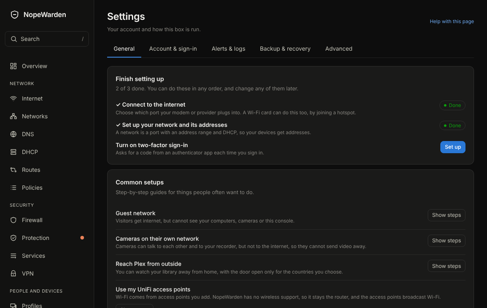

# Settings

## What it is for
Your account, and how this box is run. It is split into five tabs.

The picture is an example from a new, empty box; yours will show your own devices and numbers.

## What is on the page
- **General**: **Finish setting up** (only while something is left) and **Common setups**, **Device mode** (Router or Bridge, with a three-step change), **Updates** (**Check now**, **How often to check**, **Off**, **Notify** or **Automatic**), **Power** (restart or shut down), **Console address**, **Your place on the map** (**Find a place** by zip or postal code, city or address, or type your latitude and longitude, click the map or pick a country; only the words you search for are sent, to OpenStreetMap, and the saved place stays on this machine and is placed within about a degree) and **Appearance**.
- **Account & sign-in**: **Two-factor sign-in**, **Password**, **Where you are signed in** and **Remote login** (SSH, off unless you turn it on; if the machine has no SSH identity yet, NopeWarden makes one when you turn it on).
- **Alerts & logs**: **Alerts** (ntfy or email, with quiet hours), **Send logs elsewhere**, **Send traffic records (NetFlow / IPFIX)**, SNMP and **Storage** (what is kept on this machine's disk, about how much room each kind takes, and when it is removed).
- **Backup & recovery**: **Backups**, **Changes** (a copy before every change, to go back to), **My network** (a printable summary with a map) and **Reset to default**.
- **Advanced**: **High availability** (two boxes as a pair), **Bridge mode** (all the detailed settings), **Traffic labels**, **Guest sign-in page** and **Lists used for blocking** (the version of the app names and topic lists NopeWarden blocks by).

Administrators see all five tabs. Other accounts see only their own sign-in settings and Appearance. The page reopens on the tab you used last.

## The Advanced and alert cards in more detail
- **Send logs elsewhere**: copies NopeWarden's events to a syslog server you run, such as a NAS or a log tool. Enter its address and port, switch it on, and watch the card for the last send. It is off by default, and a server that is down never slows the firewall.
- **Send traffic records (NetFlow / IPFIX)**: tells a traffic-analysis tool which devices talked to which, and how much. Only the collector you name receives it. Off by default.
- **High availability**: two NopeWarden machines as a pair. One is active; if it fails, the other takes over within seconds and devices keep their addresses. Bridge mode and a pair cannot be used together yet.
- **Let a monitoring tool read this device (SNMP)**: read-only, shows the name, uptime and each port's traffic to a tool such as a graphing server. Off by default; set a community string before you switch it on.
- **Bridge mode**: use NopeWarden as a filter between another router and your network without routing or changing addresses. Switch it on from **Device mode** first; this card holds the detailed settings.

- **Storage**: a table of everything NopeWarden keeps (connections, DNS lookups, activity, device traffic, data by country, overview charts, speed tests, threat alerts, outages and firewall change copies) with its entries, estimated size, oldest entry and the rule that removes it. Set how long alerts and outages are kept, and how many firewall change copies to keep. **Clean up now** applies the rules straight away. Sizes are estimates.

## Common tasks
1. Change mode: **General**, **Device mode**, **Change**, then follow the three steps. Nothing is saved until the last step, and you have 60 seconds to keep it.
2. Turn on two-factor sign-in: **Account & sign-in**, **Turn on**, scan the code.
3. Make a backup: **Backup & recovery**, **Back up now**.

## Example
Use **Notify** for updates: NopeWarden tells you when one is ready and you press **Update now** when it suits you.

## If something goes wrong
A mode change that is not kept goes back on its own, and the card says so. See Getting back in for lock-outs.

## One schedule for every recurring job
Update checks, blocklist refreshes, country lists and threat rules all use the same schedule editor: **Every N hours**, **Daily at** a time, **Weekly on** a day and time, or **Off**. The sentence beside it says in plain English when the next run is. A job that fails retries after 5 minutes, 15, 30, and then every hour until it works.
