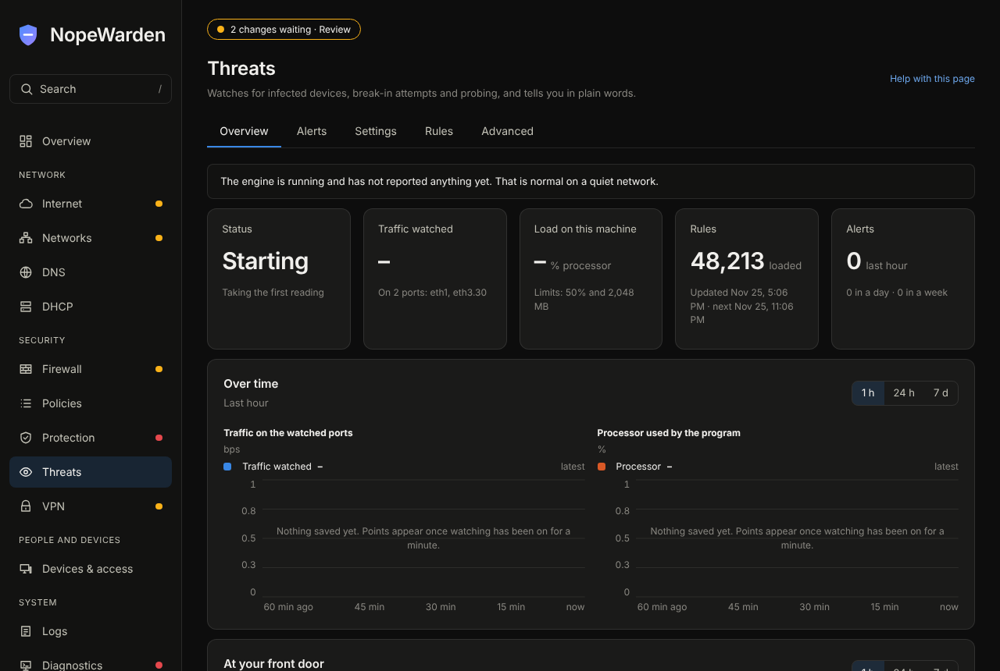
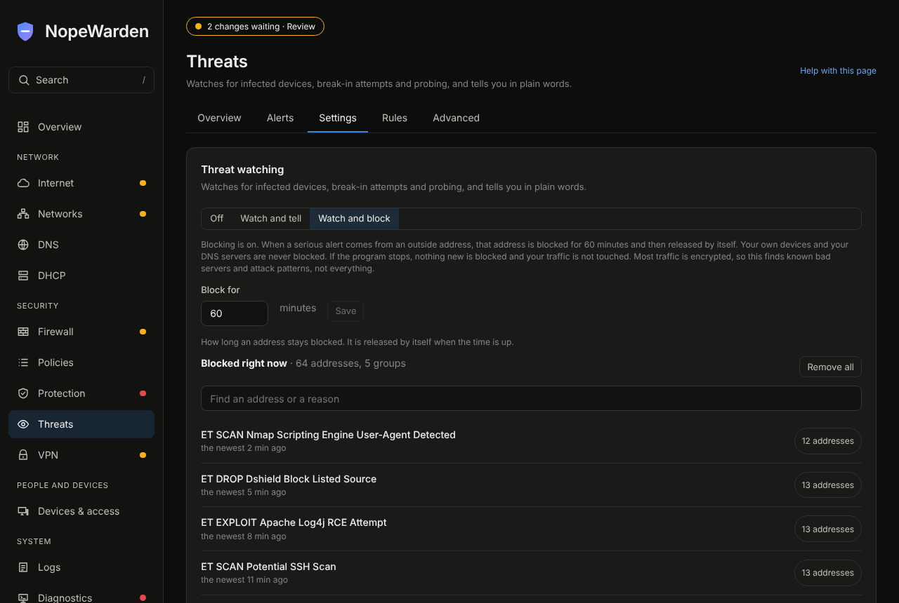

# Threats

## What it is for
Watching for infected devices, break-in attempts and probing, and telling you about them in plain words. It is an extra program that is installed only if you ask. It reads copies of your traffic and never holds it up. If you choose, it can also block the address behind a serious alert (see **Watch and block** below).

The picture uses made-up devices and numbers. Yours will show your own.

## What is on the page
One row of tabs along the top: **Overview**, **Alerts**, **Settings**, **Rules** and **Advanced**.
- **Overview** comes first.
  - At the top are the status line, the number cards and **Over time**. After installing, it opens on one line that says where things stand (off, watching, or in trouble) and where to go next. The cards are **Status**, **Traffic watched** (on the watched ports), **Load on this machine** (processor and memory against their limits), **Rules** (how many are loaded, when they were updated and when the next update is due) and **Alerts** (last hour, day and week). Charts cover the last hour, day or week.
  - **At your front door** also shows before the program is installed. It counts attempts from the internet that the firewall blocked, for 1 h, 24 h or 7 d. **Who is probing you** lists the busiest addresses with the country, a plain reason such as trying many doors, the doors they tried, and **Copy address**. **Doors being tried** lists the most tried ports and how many addresses tried each. **Aimed at** shows which of your networks they were aimed at. A strip of the last 30 days darkens with each day's worst hour. Hover a day to read it.
  - Below are **What was seen** (alerts by kind), **Devices involved** and **What changed** (rule updates, switch-offs and changes).
  - Until the program is installed, the rest of the tab is the install page. **What threat watching does** says what you get, what it costs and that nothing is installed until you ask. **Install threat watching** tells you the packages, the download size, the disk space and any worry about this machine's memory or processor before you agree. While it installs, or is removed, a ticked list shows the step it is on.
- **Alerts** show what was noticed in plain words, named after the device (the name you gave it, or its network name). The same thing happening many times is one row with a count. Harmless engine chatter is kept in a folded section at the bottom. Each row has **Allow for this device**, **Allow for all** and **Never check this device**.
- **Settings** holds everything you set once the program is installed. It has **Threat watching** (the switch **Off**, **Watch and tell** or **Watch and block**, which moves as soon as you click and says what it is doing, with the plain explanation of what it does and does not do), **How closely to watch** (Light, Balanced, Strict or Custom), **Limits** for the processor and memory, and **The program**, where **Remove threat watching** is. **Custom** appears once you change a group under Rules; **Restore defaults** goes back to the setting's own groups.
- **Rules** has **Update rules now**, **Roll back to the previous rules**, **Groups of checks**, **Single checks**, **Allowed checks** (things you let through; remove one to be told about it again) and **Devices never checked**. Each group has a plain description. Switch groups on or off, then press **Apply**; nothing changes until you do, and **Discard** drops your changes.
- **Advanced** has **Save or load your tuning**, **Reset all threat settings**, **Program log** (the last lines the program wrote, the first place to look when it is not running) and **Where it writes**.

## Common tasks
1. Turn on threat watching: **Overview**, **Install threat watching**, read the sizes, **Install**. When it finishes, choose **Watch and tell** under **Settings**.
2. Quiet a harmless alert: **Alerts**, **Allow for this device**.
3. Lower its load on a small machine: **Settings**, choose **Light**, or lower the **Limits**.
4. Make your own set: **Rules**, switch groups, **Apply**. To undo, **Settings**, **Restore defaults**.
5. Go back after a bad rule update: **Rules**, **Roll back to the previous rules**.
6. Take it off the machine: **Settings**, **Remove threat watching**.

## What happens if something goes wrong
Threat watching only adds protection. If it fails, the protection goes and your internet carries on: your traffic is never held up.
- It reads copies of the traffic. If it stops, crashes or is removed, nothing changes for your devices.
- If it uses all of its processor share for ten minutes, NopeWarden switches it off by itself, says why on this page and in the Logs, and leaves it off until you switch it on again.
- Blocking threats (**Protect**) is not available. It stays off until watching has proved itself on real traffic.
- Most traffic is encrypted, so watching finds known bad servers and attack patterns, not everything.

## Example
A new camera starts talking to an address on a bad list. The **Alerts** tab shows "A device may be infected and talking to a known bad server", with the camera's name. You unplug it, or choose **Never check this device** if you know it is fine.

## If something goes wrong
If the page says **The program keeps failing**, the program starts and stops again and again; read the reason, then **Program log** under **Advanced** (or Diagnostics in the left menu). If **Install threat watching** fails, the page shows the reason; try again once the internet works and there is disk space. If the page says the program is not running, your traffic is not affected and NopeWarden keeps trying to start it. If it keeps stopping, choose **Light** under **Settings**. If a rule update breaks things, use **Roll back to the previous rules**.

## Looking up names in alerts
**Threat alerts** look up the name behind an address and try again if the first lookup finds nothing; **Look up again** retries now.

## Watch and block
**Watch and block** is **Watch and tell** plus one more thing. When the engine reports a serious alert and the other end is an ordinary address on the internet, NopeWarden puts that address on a block list for a while (60 minutes unless you change **Block for**, from 5 minutes to 24 hours). While it is listed, nothing from it gets in and nothing from your network gets to it, in either direction. When the time is up it is released by itself. It is off until you choose it.

The **Blocked right now** list groups addresses by the kind of alert that caused them, for example one row for a scan with a count of addresses; open a row to see each address and **Remove** it. The newest ten groups show first, **Show all** lists the rest, and once there are many a search box finds an address. The header shows how many addresses are blocked, with **Remove all**. The list holds up to 4,096 addresses; if it ever fills, the page says so, new addresses are not blocked, and the Logs record it.

Each block, and each removal, is written to the Logs.

The picture uses made-up addresses.

It is careful: your own devices and networks, addresses on your own side, the DNS servers you use and this machine's own addresses are never blocked, and only the most serious alerts count. A check you have allowed or a device you never check does not lead to a block. This works for IPv4 addresses. If the engine stops, nothing new is blocked and your traffic is not held up, because traffic does not pass through the engine. The blocks already made end when their time is up.

This is not the same as inline blocking, where each packet waits for the engine. NopeWarden may let the first few packets of an attack through before the address is blocked.

## Block as it happens
**Block as it happens** goes one step further than **Watch and block**. Watch and block reacts after the first packets of an attack have already gone through, by blocking the address. Block as it happens holds each packet for a moment while the engine checks it, and drops the ones that match a check set to **Block**, so the attack never arrives. It works like the inline mode in pfSense, OPNsense and IPFire, and it is off until you choose it.

What is checked: traffic the firewall has already allowed, between a checked network and the internet, in both directions. Traffic the firewall drops is never checked, traffic between your own networks is not checked, and traffic to this firewall itself (the console, SSH) is not checked. Under **Networks to check** you can leave a network out. All networks that reach the internet are checked to start with.

**What each group of checks does** gives every group a setting: **Off** (not looked for), **Alert** (noted in the alerts, nothing is stopped) or **Block** (matching traffic is dropped). To start with, only known malware and its servers, exploit attempts and exploit kits are set to Block. Scans, policy, peer-to-peer, games, chat, DNS and user-agent checks start on Alert. Lists of bad addresses are never used to block, because they are noisy. Turn blocking on one group at a time and watch the alerts for a few days before adding the next.

On an alert, **Stop blocking this** keeps alerting about that one check but stops dropping its traffic, and **Never check this address** skips that device when checking. Both appear under **Changes you made**, each with **Undo**. You can also type an address or network to never check.

It is built so it cannot cut your internet. The checks wait in a queue that is set to let packets through if the engine is not listening or is too busy to keep up, a watchdog restarts the engine if it stops, and **Keeping up** or **Falling behind** on the page tells you which it is. A red notice appears on the Overview if checking stops, with **Back to Watch only** beside it to turn blocking off at once. Checking every packet needs a processor with at least two cores and about 4 GB of memory, and is slow on virtual machines; the page warns you when this machine looks too small. To prove blocking works, open the **Try it** address from a device on a checked network: the page should not load, and a blocked alert appears.

