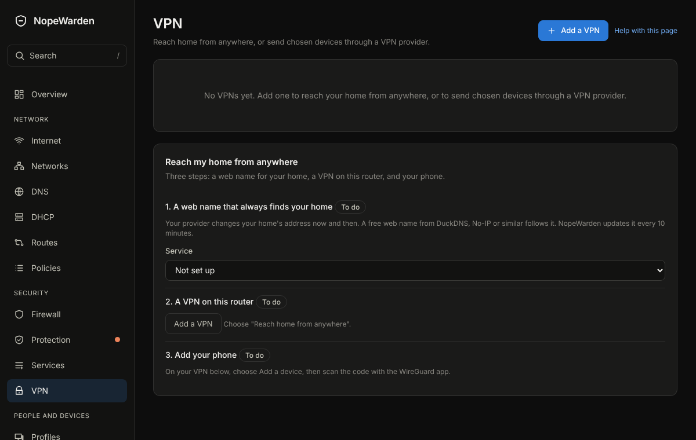

# VPN

## What it is for
Send some devices through a VPN provider, let your phone reach home from anywhere, or join two sites together.

The picture is an example from a new, empty box; yours will show your own devices and numbers.

## What is on the page
- **Add a VPN** starts a guided choice: use a provider's file, let devices reach home, or **Join two sites**.
- Each VPN has a card with its state in words. For a provider VPN: **Who uses it?** (**Whole networks**, **Device groups** or **Individual devices**), **Kill switch**, **Test address**, **Internet sees you as** and **Checked**.
- **Packet size** on a provider card is the biggest packet that fits through the tunnel, with where the number came from: *measured*, *from the profile*, or *default, could not confirm*. **Test packet size** measures it now and shows what each test address answered.
- **Test addresses** (a card below your provider VPNs) holds the lists used to measure the packet size and to find the address the internet sees. You can add, change, remove and reorder entries, and **Restore defaults** puts the built-in lists back.
- **Check** beside a device shows, by itself every few seconds, whether its connections and name lookups really leave through the VPN.
- For a VPN to reach home: **Add a device** gives a file and QR code for a phone or laptop. **Devices connect to** shows the address they use.
- **Join two sites** makes a code you take to the other site.

## Common tasks
1. Send your computer through a provider: **Add a VPN**, drop the provider's file, choose **Individual devices** and pick the computer, **Add and connect**.
2. Reach home from your phone: **Add a VPN**, choose to reach home, name the first device, scan the QR code.
3. Check it works: press **Check** next to the device.

## Example
Set **Kill switch** on for a device that must never use your normal connection. If the VPN drops, that device loses internet rather than leaking.

## If something goes wrong
**Needs attention** says what failed. If a device shows your normal connection under **Internet sees you as**, press Check, then **Review and apply** if it says the address changed. With the kill switch off, name lookups fall back to the normal connection while the VPN is down, and the card says so.

## Packet size
A tunnel has to fit inside the packets of the connection under it, and its own wrapping takes room. If the tunnel is set too high, small packets such as a ping still pass, so the card can say **Working**, while big ones, such as a secure web page, are dropped without a word. Pages then stall or never load.

Gatehouse measures this for every VPN that goes out to a provider or another site, and sets the size itself:
- It starts from the size the provider's file asks for (`tun-mtu`), or the usual size for the kind of tunnel (1500 for OpenVPN, 1420 for WireGuard) and steps down through 1500, 1460, 1420, 1400, 1380, 1360, 1340, 1300 and 1280 until packets get through. 1280 is the lowest, the smallest size the internet must carry.
- It sends the tests to all the addresses in the list at once. An address that never answers a ping is left out. The largest size that at least two addresses answer is used. If only one address answers, its answer is used.
- It measures again straight away after the tunnel disconnects and reconnects, again when a big packet stops getting through while small ones still do (checked about every 20 seconds), and in full every 30 minutes.
- If small packets pass but no size could be confirmed, the tunnel uses 1280 and the card says so. Gatehouse tries again after 10 seconds, 30 seconds, 1 minute and then every 5 minutes, and moves up as soon as a bigger size passes.
- If nothing answers at all, the tunnel is not passing traffic, and no size is claimed.

The same size applies to everything that crosses the tunnel, so the firewall's rule that trims the size of web connections follows it automatically.

**Test packet size** runs the same test on demand, applies the answer, and shows each size with the addresses that answered it.

## The address the internet sees
Gatehouse asks one service after another, out of the tunnel, until one answers with a plain public address. The built-in order is Google (a small DNS lookup), Amazon's check page, Cloudflare (a small DNS lookup), then Cloudflare's trace page. A failed lookup is tried again on the next round (about 20 seconds); a good answer is kept for ten minutes, and asked again at once after a reconnect. When it cannot be found, the card says why.

A provider that quietly redirects name lookups could make a DNS answer wrong. Gatehouse skips any answer that is not a public address and moves to the next service.

## Test addresses
The **Test addresses** card has two lists. The first holds the plain IPv4 addresses used for the packet size test (built in: 1.1.1.1, 8.8.8.8, 1.0.0.1, 8.8.4.4, 9.9.9.9). The second holds the services asked for your address, written as `dns:google`, `dns:cloudflare` or `web:https://host/path`. Each list can have up to 8 entries, and an entry in neither list can be a name, because a name would need DNS to work first. A VPN's own **Test address**, when you set one, is always tried first for that VPN.
